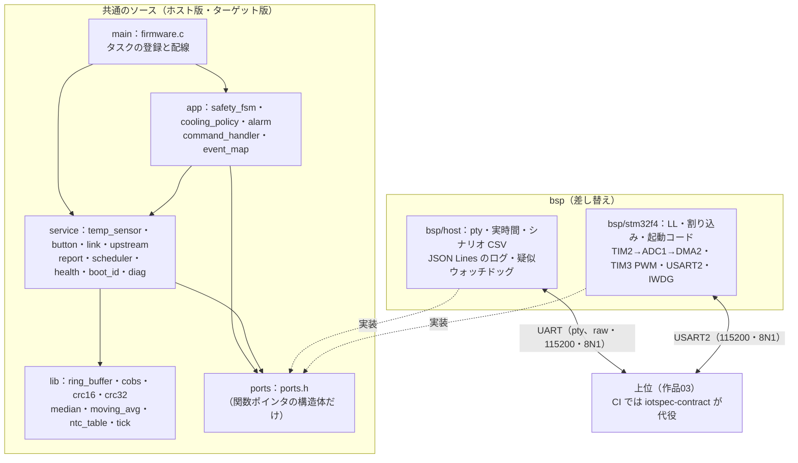
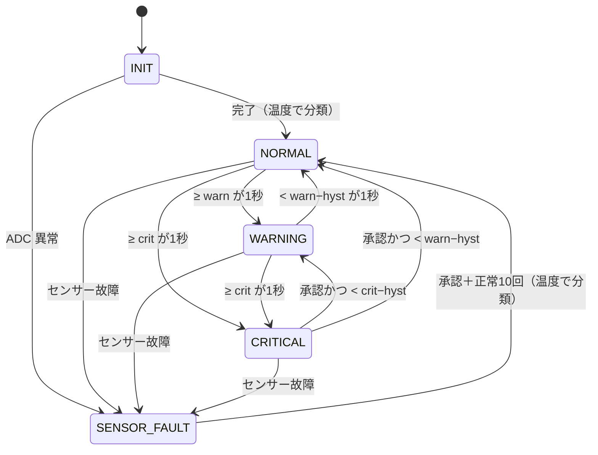

# iot-thermal-guard-stm32

[](https://github.com/io0323/iot-thermal-guard-stm32/actions/workflows/ci.yml)

温度を監視してファンを回し、異常を LED・ブザー・UART で知らせる、STM32F401RE 向けのベアメタルのファームウェアです（C11、作品01「高機能センサー制御・安全監視デバイス」、device_id `mcu-c-01`）。
上位（作品03）がいなくても、単独で安全側（ファン全開・警報）に倒します。上位とは [iot-common-spec](https://github.com/io0323/iot-common-spec) v0.2.1 の UART フレームでやり取りします。
**確かめた範囲**：PC で動くホスト版（単体テスト・ゴールデン・仮想時間のシナリオ・契約テスト・pytest）と、Renode（エミュレーター）の上のターゲット版（Robot Framework・契約テスト）。すべて CI で動きます。
**実機（Nucleo-F401RE）ではまだ確かめていません。** 実機でしか確かめられないことは [docs/hardware-phase.md](docs/hardware-phase.md) に手順として残しています。

## 構成

5層（app・service・lib・ports・bsp）で、ハードに触るのは bsp だけです。ports は関数ポインタの構造体で、起動時に bsp が中身を詰めて上位の層に渡します。app・service・lib・main はホスト版とターゲット版で同じソースで、bsp だけを差し替えます（[基本設計書 第4章](docs/design/01-requirements-basic-design.md)、[詳細設計書 第1・2章](docs/design/02-detailed-design.md)）。



依存は app → service → lib、app・service → ports の一方向だけです。CMake のターゲットを層ごとに分け、STM32 のヘッダを include できるのは `bsp/stm32f4/` だけにしています（品質ゲートの「禁止項目」で検査）。

## 状態遷移

5つの状態を、`{現状態, 条件, 次状態}` の静的な表で上から順に評価します（`app/safety_fsm.c`）。CRITICAL と SENSOR_FAULT は温度が下がっても自動では戻らず、ボタンでの承認を待ちます。センサー故障はどの条件よりも先に評価します。図は [詳細設計書 第4章](docs/design/02-detailed-design.md) と同じものです。



既定のしきい値は warn 45.00℃・crit 60.00℃・hyst 3.00℃（`config/thresholds.h`）。ファンは NORMAL で 35〜45℃ に 0→40%、WARNING 70%、CRITICAL・SENSOR_FAULT 100% です。

## 検証の全体像

要件（FR-01〜14・NFR-01〜10）とテストの対応は [docs/test-spec.md](docs/test-spec.md) にあり、CI の quality ジョブが `tools/check_traceability.py` で表の抜けと、実在しないテスト名を検査します。

| 段 | 何を確かめるか | 件数 | CI のジョブ |
| --- | --- | --- | --- |
| 単体 | lib・service・app の各モジュール（Unity、ポートはフェイク）。遷移表の全行、指令の全検証条件、重複キャッシュ、COBS・CRC | 24 実行ファイル・211 件 | host |
| ゴールデン | iot-common-spec v0.2.1 の `uart/golden/` 全件の符号化・復号・壊れたフレーム | 5 件 | host |
| 仮想時間のシナリオ | firmware 全体を 1ms 刻みの仮想時間で CSV から動かす（NFR-01、故障、承認、長押し、hang） | 26 件 | host |
| 契約 | `iotspec-contract --role mcu-c-01` の7チェック（ホスト版） | 7 件 | host |
| pytest | ホスト版を pty 越しに動かし、hang → 疑似ウォッチドッグの再起動 → 新しい boot_id | 5 件 | host |
| 品質ゲート | カバレッジ 80% 以上・MISRA（cppcheck）・clang-tidy・複雑度 10 以下・Doxygen・禁止項目、トレーサビリティ | 6 ゲート＋1 | quality |
| ターゲット | target-debug・target-release を警告ゼロでビルド、Flash・RAM・スタック・ISR の検査 | 4 検査 × 2 | target |
| Renode | target-renode を Renode で動かす（Robot Framework）と、Renode の上での契約テスト | 7 件＋7 チェック | renode |

単体・ゴールデン・シナリオは CTest の27の実行ファイルで、件数は `RUN_TEST` の数です。

## 主な数値

どれもテストや CI の出力にある値です。CI の値は main（`a188fd6`）の [run 44911885413](https://github.com/io0323/iot-thermal-guard-stm32/actions/runs/44911885413) のものです。

| 項目 | 値 | 基準 | 出典 |
| --- | --- | --- | --- |
| NFR-01：crit を超えてからファン100% まで | 1,500 ms（1℃/s）・1,500 ms（10℃/s）・1,525 ms（40℃/s） | 2,500 ms 以内 | `./build/host/tests/test_scenarios` の出力（仮想時間）、PR #2 |
| hang からの再起動（ホスト版、実時間） | hang から新しい boot_id の STATE まで 1,504 ms | 400〜2,600 ms（open-questions #34） | pytest の出力（CI の host ジョブ）、PR #3 |
| hang からの再起動（仮想時間） | hang 3,000 ms → 再起動 3,400 ms → STATE・BOOT 4,500 ms | — | `test_scenarios` の出力 |
| Flash（target-release） | 14,708 / 65,536 バイト（22.4%） | 64KB 以内（NFR-04） | CI の target ジョブ（`tools/check_size.py`） |
| RAM（target-release、スタック 4KB を含む） | 5,684 / 16,384 バイト（34.7%） | 16KB 以内（NFR-04） | 同上 |
| スタックの最悪の深さ（見積もり） | 1,560 / 4,096 バイト（38.1%） | 4KB 以内 | CI の target ジョブ（`tools/stack_report.py`） |
| スタックの最大使用量（Renode で実行、塗りの残り） | 1,204 バイト | 見積もり以下 | CI の renode ジョブ（Robot の「スタック」、`tools/renode-stack-margin.sh`） |
| ISR の実行時間（見積もり） | 最悪 2.65 μs（USART2） | 各 20 μs 以内（NFR-03） | [docs/isr-review.md](docs/isr-review.md)（`tools/isr_report.py`） |
| 行カバレッジ（app・service） | 93%（app 94%、service 92%） | 80% 以上（NFR-08） | CI の quality ジョブ（gcovr）、PR #4（93.4%） |
| Renode の仮想時間と実時間の比（契約テストの設定） | 0.88〜0.98 倍 | 0.7〜9 倍 | [ADR-0006](docs/adr/ADR-0006-renode.md)、CI の renode ジョブ（`tools/renode-contract.sh --measure 20`） |

実機での値（NFR-01〜03 の実測、IWDG の時間、スタックの実測）はまだありません（[docs/hardware-phase.md](docs/hardware-phase.md)）。

## 書類の地図

| 場所 | 内容 |
| --- | --- |
| [docs/design/](docs/design/) | 要件定義・基本設計書、詳細設計書、共通仕様の変更案（Claude Docs の原本の写し。指示がない限り編集しない） |
| [docs/adr/](docs/adr/README.md) | 設計判断の記録（ADR-0001〜0006：回路の前提、MISRA の逸脱、テストの基盤、ツールチェーン、クロック・ピン、Renode） |
| [docs/test-spec.md](docs/test-spec.md) | テスト仕様書。FR・NFR とテストの対応表、受け入れ基準 |
| [docs/hardware-phase.md](docs/hardware-phase.md) | 実機フェーズの手順書。実機でしか確かめられないことを1項目ずつ |
| [docs/isr-review.md](docs/isr-review.md) | ISR のレビュー表と実行時間の見積もり |
| [docs/open-questions.md](docs/open-questions.md) | 未決の論点と決定の記録（仕様にないことは、ここに書いて人が決めた） |
| [docs/prompts/](docs/prompts/README.md) | フェーズごとに Claude Code に渡したプロンプト（P1〜P7） |
| [CHANGELOG.md](CHANGELOG.md) | 版ごとの変更（v0.1.0） |
| [CLAUDE.md](CLAUDE.md) | Claude Code が守る決まり（正とする書類の順、コードの決まり、コマンド） |

## 開発の進め方

設計書（[docs/design/](docs/design/)）と [CLAUDE.md](CLAUDE.md) をもとに、Claude Code にフェーズごと（P1〜P7、[詳細設計書 第10章](docs/design/02-detailed-design.md)）のプロンプトで実装させました。プロンプトは [docs/prompts/](docs/prompts/README.md) にあります。

- 各フェーズは main から `phase/pN-…` を切り、完了条件をすべて満たしてから PR にし、人がレビューしてマージしました
- 仕様や設計書にないことは Claude Code が実装で決めず、[docs/open-questions.md](docs/open-questions.md) に選択肢と推奨を書いて作業を止め、人が決めました（「決定」の列。#1〜#7 は未決のまま：共通仕様の CR-1〜5 と実機フェーズ）
- 設計の誤りが見つかったときは、人が設計書の原本を直し、リポジトリの写しを同じように直すよう指示しました

## 必要なもの

- CMake 3.25 以上、Ninja、C11 のコンパイラ（clang または gcc）、Python 3、git
- 契約テストと再起動の結合テストを動かすには [uv](https://docs.astral.sh/uv/)（結合テストは Python 3.12 を使う。`.python-version` で指定しているので uv が用意する）
- 品質ゲート・ターゲット版のビルド・Renode を手元で流すには Docker（下の「品質ゲート」「ターゲット版」「Renode」）

Ubuntu 24.04 での準備の例：

```sh
sudo apt-get update && sudo apt-get install -y git cmake ninja-build gcc python3 curl
curl -LsSf https://astral.sh/uv/install.sh | sh && export PATH="$HOME/.local/bin:$PATH"
git clone --recurse-submodules https://github.com/io0323/iot-thermal-guard-stm32.git && cd iot-thermal-guard-stm32
```

## ビルドとテスト

```sh
git submodule update --init --recursive
cmake --preset host-debug && cmake --build --preset host-debug   # ASan・UBSan 付き、警告はエラー
ctest --preset host-debug --output-on-failure                     # 単体テスト・ゴールデン・シナリオ
./build/host/tests/test_scenarios                                 # シナリオの実測値（NFR-01 など）を表示
```

## 温度の変換表

`tools/gen_ntc_table.py` がビルド時に `build/generated/ntc_table_data.h` を作ります（生成物は手で編集しない）。
回路は 3.3V → 10kΩ プルアップ → ADC → NTC（10kΩ、B=3435）→ GND、12ビットで、生値 = round(4095 × R ÷ (R + 10kΩ))。

| 温度 | 生値 |
| --- | --- |
| −20℃（表の端） | 3627 |
| 25℃ | 2048 |
| 120℃（表の端） | 238 |

生値 50〜237・3628〜4045 は 120.00／−20.00℃ に丸め、50 未満・4045 超が3回続いたら短絡・断線とします。

## 契約テスト

```sh
uv tool install "iotspec @ git+https://github.com/io0323/iot-common-spec@v0.2.1"
iotspec-contract --role mcu-c-01 --target-cmd "./build/host/mcu_c_01 --log contract-log.jsonl {uart}" --junit contract.xml
```

7つのチェック（boot_order、ack、duplicate_cmd_ref、upstream_lost_restored、frame_encoding、seq_per_type、converted_schema）を行います。
10秒の途絶を含むので、1回におよそ15秒かかります。MQTT ブローカーは要りません。

## 再起動の結合テスト（pytest）

```sh
uv run --with "iotspec @ git+https://github.com/io0323/iot-common-spec@v0.2.1" --with pytest pytest tests/host_integration
```

pty の組を作ってホスト版を `--scenario tests/scenario/data/hang_reboot.csv` で動かし、iotspec の `FrameReader`（`decode_frame`）でフレームを読みます。
3000ms の `hang` のあと、疑似ウォッチドッグで起動し直して別の boot_id の STATE → BOOT が来ること（hang から 400〜2600ms）、
再起動後の seq と uptime_ms が 0 から始まること、ログの boot の行が `watchdog`・1 になることを確かめます。実測した時間は出力に表示されます。

## ホスト版の使い方

```text
mcu_c_01 [--temp <℃>] [--scenario <file.csv>] [--log <file.jsonl>] [UART_PATH]
```

| 引数 | 既定 | 内容 |
| --- | --- | --- |
| `UART_PATH` | 環境変数 `IOTSPEC_UART_PATH` | 開くシリアル（raw・115200・8N1）。両方なければ終了コード 2 |
| `--temp` | 25.0 | 固定の温度。上の式で ADC の生値に戻して渡す |
| `--scenario` | なし | シナリオ CSV を実時間で再生する。`--temp` より優先。不正な CSV は終了コード 2 |
| `--log` | 標準エラー | JSON Lines のログ |

- SIGTERM・SIGINT、または相手が UART を閉じたら、診断値をログに書いて終了コード 0 で終わります。SIGUSR1 で診断値を書き出します
- ボタンはシナリオの `button_down`〜`button_up` で押します。LED とブザーはログ（`led`・`buzzer`）に出します

### 疑似ウォッチドッグと再起動

ファームウェアは100ms ごとに、sense・control・link・ui の生存報告と report の期限（最後の実行から1500ms 以内）を確かめてからウォッチドッグをリフレッシュします。
最後のリフレッシュから500ms たつと、ホスト版は診断値をログに書き、次の環境変数を付けて同じ引数で自分自身を `execv()` します。
UART とログのファイルは `O_CLOEXEC` で開いていて、起動し直したプロセスが開き直します（ログは追記）。

| 環境変数 | 内容 |
| --- | --- |
| `MCU_C_01_RESET_REASON` | リセット要因（`power_on`・`pin`・`watchdog`・`software`・`brownout`・`low_power`・`unknown`）。なければ `power_on` |
| `MCU_C_01_RESET_COUNT` | リセット回数（0xFFFF で止まる）。なければ 0。あればログを追記で開く |
| `MCU_C_01_SCENARIO_ELAPSED_MS` | シナリオの時刻の引き継ぎ。再起動してもシナリオは続き、`hang` は1回だけ起きる。uptime_ms は 0 から数え直す |

### シナリオ CSV

`t_ms,temp_c,event` の3列です（例は [tests/scenario/data/](tests/scenario/data/)）。仮想時間のテスト（sim_harness）とホスト版で同じ形式を使います。

- 温度は次の行まで線形につなぎ、最後の行のあとは最後の温度のまま。t_ms はシナリオを始めてからのミリ秒で、増える順
- 1行目が `t_ms` で始まればヘッダとして読み飛ばす。`#` の行と空行は読み飛ばす。改行は LF・CRLF のどちらでもよい
- temp_c は全行に必須。event は空か、`sensor_open`（生値 4095）・`sensor_short`（生値 0）・`sensor_ok`（温度からの値に戻す）・`adc_stall`（値を出さない）・`adc_resume`
- `button_down`・`button_up`（ボタンのレベル。短押しは3000ms 未満、長押しは3000ms 押し続ける）、`hang`（ファームウェアのループを止める。疑似ウォッチドッグの監視は続く）

### ログのキー（JSON Lines）

すべての行に `t_ms`（起動からのミリ秒）と `kind` があります。

| kind | キー |
| --- | --- |
| `boot` | `boot_id`（16進8桁の文字列）、`reset_reason`、`reset_count` |
| `state` | `from`、`to`（状態名） |
| `fan` | `pm`（PWM に書いた duty、‰） |
| `led` | `led`（`green`・`yellow`・`red`）、`on` |
| `buzzer` | `on` |
| `tx`・`rx` | `type`（種別名）、`seq`、`fields`（下表）、`hex`（符号化済みのバイト列。末尾の `00` を含む） |
| `rx_error` | `reason`（`cobs_error`・`length_mismatch`・`crc_mismatch`・`unexpected_type`・`rx_overflow`）、`hex` |
| `diag` | `reset_reason`、`reset_count`、`rx_cobs_errors`、`rx_len_errors`、`rx_crc_errors`、`rx_unexpected`、`rx_overflow`、`cmd_dropped_init`、`cmd_duplicates`、`tx_dropped`、`temp_clamped`、`temp_rejected`、`max_loop_cycles`、`max_task_cycles`（sense・control・link・ui・report・health の順の配列）、`overruns`、`uart_ring_dropped`・`uart_errors`・`stack_peak`（bsp の診断値。ホスト版はいつも 0）。ホスト版の cycles はナノ秒 |

| type | `fields` のキー |
| --- | --- |
| TELEMETRY | `uptime_ms`、`temp_c100`、`quality`、`state`、`fan_pm` |
| EVENT | `uptime_ms`、`code`、`severity`、`from`、`to`、`temp_c100` |
| HEARTBEAT | `uptime_ms` |
| STATE | `fw_version`、`boot_id`（16進8桁の文字列）、`period_ms` |
| CMD | `cmd_ref`、`op`、`ttl_s`、`args`（16進の文字列） |
| ACK | `cmd_ref`、`status`、`reason`、`limited`、`applied` |

## 品質ゲート

CI の `quality` ジョブ（ubuntu-24.04）で、次のゲートをすべて通ることを確かめます。どれか1つでも落ちたら失敗です。
**ルールの結果はツールの版で変わるので、合否は CI の結果を正とします。**

| ゲート | ツール（CI の版） | 合格の基準 | 設定 |
| --- | --- | --- | --- |
| カバレッジ | gcc 13.3＋gcovr 8.x（プリセット `host-coverage`） | app・service の行カバレッジ 80% 以上 | `CMakePresets.json`、`cmake/coverage.cmake` |
| MISRA C:2012 | cppcheck 2.13.0（`--addon=misra`） | 抑止されていない指摘ゼロ。必須規則（Mandatory）の逸脱なし | `misra-suppressions.txt`、[ADR-0002](docs/adr/ADR-0002-misra-deviations.md) |
| clang-tidy | clang-tidy 18.1.3 | 指摘ゼロ（`WarningsAsErrors: '*'`） | `.clang-tidy` |
| 循環的複雑度 | lizard 1.26.1 | 10 以下（app・service・lib・main・bsp/host・bsp/stm32f4） | `tools/quality.sh` |
| Doxygen | doxygen 1.9.8 | 警告ゼロ（app・service・lib・ports の公開ヘッダ） | `Doxyfile` |
| 禁止項目 | grep | app・service・lib に malloc 系・float・double・STM32 がない。bsp/stm32f4 に malloc 系・float・double がない。STM32・CMSIS のヘッダの include は bsp/stm32f4 だけ | `tools/check_forbidden.sh` |

- 対象は app・service・lib・ports・main です（lizard は bsp/host・bsp/stm32f4 も）。bsp・tests・third_party・external は対象外です。bsp/stm32f4 を cppcheck・clang-tidy の対象にしない理由は ADR-0002 にあります（CMSIS のレジスタのマクロが規則 11.4・11.6 に当たるため、#49）
- MISRA の逸脱は [ADR-0002](docs/adr/ADR-0002-misra-deviations.md) に1件ずつ書きます。規則の再分類（GRP）の一覧は ADR-0002 の「[規則の再分類](docs/adr/ADR-0002-misra-deviations.md#規則の再分類grp)」にあり、今は規則 15.5 だけを Disapplied にしています
- 設計判断の記録は [docs/adr/](docs/adr/README.md) にあります

### 手元で流す

cppcheck・clang-tidy・Doxygen は、手元でも CI と同じ ubuntu:24.04 のコンテナで流します（Homebrew の版の違いで結果がずれないように）。要るのは Docker だけです。

```sh
tools/quality-docker.sh        # 報告は build/quality-docker/（summary.txt、各ツールの出力、coverage/index.html）
```

CI はコンテナを使わず、同じ `tools/quality.sh` を直接呼びます。ツールがそろった環境なら `tools/quality.sh [出力先]` でも流せます。

## ターゲット版（STM32F401RE、実機では未確認）

Nucleo-F401RE 向けのビルドです。app・service・lib・main はホスト版と同じソースを使い、`bsp/stm32f4/` だけが違います。
**実機への書き込みと実機での動作確認はまだしていません。** 実機でしか確かめられないこと（ISR の実行時間、PWM・UART・ADC の動作、IWDG の時間、スタックの実測）は「実機フェーズで確認」として [docs/isr-review.md](docs/isr-review.md) と [ADR-0005](docs/adr/ADR-0005-clock-pins-peripherals.md) に残しています。

```sh
tools/target-docker.sh         # CI と同じ ubuntu:24.04 のコンテナで、2つのプリセットのビルドと検査。報告は build/target-docker/
```

CI の `target` ジョブは同じ `tools/target.sh` を直接呼びます。arm-none-eabi-gcc がある環境なら、次でもビルドできます。

```sh
cmake --preset target-release && cmake --build --preset target-release   # build/target-release/mcu_c_01.elf・.bin・.map
cmake --preset target-debug && cmake --build --preset target-debug       # -Og -g3、build/target-debug/
```

`tools/target.sh` が確かめること（どれかが崩れたら失敗）：

| 検査 | 基準 | 道具 |
| --- | --- | --- |
| ビルド | target-debug・target-release とも警告ゼロ（`-Werror`） | arm-none-eabi-gcc 13.2.1（ubuntu-24.04 の apt、[ADR-0004](docs/adr/ADR-0004-target-toolchain-and-vendor-code.md)） |
| サイズ | Flash 64KB・RAM 16KB（.data＋.bss＋.noinit＋スタック 4KB）以内、ヒープなし、malloc 系を持ち込まない（NFR-04） | `tools/check_size.py` |
| スタック | 可変長配列・再帰がない。最悪の深さ（main からの最深の経路＋割り込みの入れ子＋例外の枠）が 4KB に収まる | `tools/stack_report.py` |
| ISR | ループがない。命令数からの見積もりで各 20μs 以内（NFR-03） | `tools/isr_report.py` |

使用量（main の CI の target ジョブ。P6 で #54 の修正を入れたあとの値で、P5 の PR #5 の値より 4 バイト大きい）：

| プリセット | Flash | RAM | スタックの最悪の深さ |
| --- | --- | --- | --- |
| target-release（`-Os -g`） | 14,708 / 65,536 バイト（22.4%） | 5,684 / 16,384 バイト（34.7%） | 1,560 / 4,096 バイト（38.1%） |
| target-debug（`-Og -g3`） | 14,196 / 65,536 バイト（21.7%） | 5,684 / 16,384 バイト（34.7%） | 1,504 / 4,096 バイト（36.7%） |

クロック・ピン・割り込みの優先度は [ADR-0005](docs/adr/ADR-0005-clock-pins-peripherals.md) と `bsp/stm32f4/pinmap.h` にあります。

## Renode（エミュレーター、実機では未確認）

ターゲット版を Renode（`antmicro/renode:1.16.1`、digest で固定）のコンテナで動かして確かめます。詳細は [ADR-0006](docs/adr/ADR-0006-renode.md) と [renode/README.md](renode/README.md)。

```sh
cmake --preset target-renode && cmake --build --preset target-renode   # build/target-renode/mcu_c_01.elf
tools/renode-test.sh                                                   # Robot Framework のテスト（tests/renode/）
tools/renode-contract.sh --measure 20                                  # 契約テスト用の設定での仮想時間と実時間の比
iotspec-contract --role mcu-c-01 --target-cmd "tools/renode-contract.sh {uart}"   # 契約テスト（7チェック）
```

**`target-renode` は実機と ADC の開始方法が違います。** Renode の ADC は外部トリガー（TIM2 の TRGO）を持たないので、TIM2 の更新割り込みから ADC をソフトウェアで開始します（`ADC_SOFTWARE_START=1`）。DMA の転送と平均は実機と同じコードです。ウォッチドッグのテスト用の変数（`g_renode_hang`）も `target-renode` だけにあります。

Renode の `STM32DMA` は循環と半分転送を持たないので、それを足したモデル（`renode/peripherals/STM32DMA_Circular.cs`、Renode v1.16.1 の `STM32DMA.cs` をもとにした MIT のファイル）を起動時に読み込んで置き換えています。Renode 本体は変えていません。

| 確かめていること（CI の `renode` ジョブ） | 結果 |
| --- | --- |
| 起動の順序（STATE → BOOT） | 合格 |
| TELEMETRY・HEARTBEAT が仮想時間で1秒ごと | 合格 |
| DMA の循環・半分転送の割り込みが100ms ごとに交互に来る | 合格 |
| SET_FAN_OVERRIDE 400 の ACK と TIM3 の CCR1 = 1344 | 合格 |
| 25℃ → 65℃ で CRITICAL、CCR1 = 3360 | 合格 |
| ループを止めると IWDG がリセットし、STATE → BOOT を送り直す | 合格 |
| 契約テスト（Renode、7チェック） | 合格 |

### 仮想時間の比が 0.7 を下回って契約テストが落ちたとき

契約テストは実時間で待つので、Renode の仮想時間と実時間の比が 0.7〜9 倍の間にないと成り立ちません（上位断の10秒を14秒以内に判定する必要がある）。CI は契約テストの前に `tools/renode-contract.sh --measure 20` で比を測り、範囲の外なら「仮想時間と実時間の比」の段で失敗します。CI では 0.88〜0.98 倍で、下限に近いです。

CI のマシンが遅くなって 0.7 を下回ったら、Renode の `PerformanceInMips` を 10 から下げます（1命令あたりに進む仮想時間が増えるので、比が上がる。ADR-0006 の表では MIPS 10 で 0.45 倍、2 で 0.79 倍）。試すときは環境変数 `RENODE_MIPS`（`tools/renode-contract.sh` の既定は 10）で渡し、`RENODE_MIPS=5 tools/renode-contract.sh --measure 20` のように比を測り直します。CI で変えるなら `tools/renode-contract.sh` の既定を変え、ADR-0006 の「仮想時間と実時間」の表に書き足します。Robot のテストは仮想時間で判定するので、この設定に左右されません（#56）。

Renode で確かめていないこと（実機フェーズで確認）：ISR の実行時間とジッター（Renode は命令数の近似）、実機の ADC の TRGO の経路、PWM の波形、UART のボーレートの誤差、IWDG の時間の個体差、リセット要因（Renode の RCC_CSR は固定値）、boot_id の雑音。範囲の表は ADR-0006 に、実機で確かめる手順は [docs/hardware-phase.md](docs/hardware-phase.md) にあります。

## 依存しているもの（submodule）

| パス | 版 |
| --- | --- |
| `external/iot-common-spec` | タグ `v0.2.1` |
| `third_party/unity` | ThrowTheSwitch/Unity タグ `v2.7.0` |
| `third_party/cmsis_core` | STMicroelectronics/cmsis_core タグ `v5.9.0_20250520`（STM32CubeF4 v1.29.0） |
| `third_party/cmsis_device_f4` | STMicroelectronics/cmsis_device_f4 タグ `v2.6.12`（STM32CubeF4 v1.29.0） |
| `third_party/stm32f4xx_hal_driver` | STMicroelectronics/stm32f4xx_hal_driver タグ `v1.8.6`（STM32CubeF4 v1.29.0。LL のヘッダだけを使う） |

## フェーズの進み具合

| フェーズ | 内容 | 状態 |
| --- | --- | --- |
| P1 | ホスト版の骨組み・UART・契約テスト | 完了 |
| P2 | 温度計測と状態遷移 | 完了 |
| P3 | ボタン・警報・ヘルス | 完了 |
| P4 | 品質ゲート | 完了 |
| P5 | STM32 ターゲット版 | 完了（実機では未確認） |
| P6 | Renode | 完了（実機では未確認） |
| P7 | 書類の仕上げ | 実装済み（PR 中） |

### ボタンと警報

- 短押し：CRITICAL・SENSOR_FAULT で消音していなければ「消音」、それ以外は「承認」（CRITICAL・SENSOR_FAULT から戻す条件の1つ）
- 長押し（3秒）：強制全開（ファン1000）を切り替える。再起動で解除され、上位断では解除しない
- LED とブザーのパターンは詳細設計書 第5章の表のとおり。強制全開中の NORMAL は緑が 2Hz で点滅する
