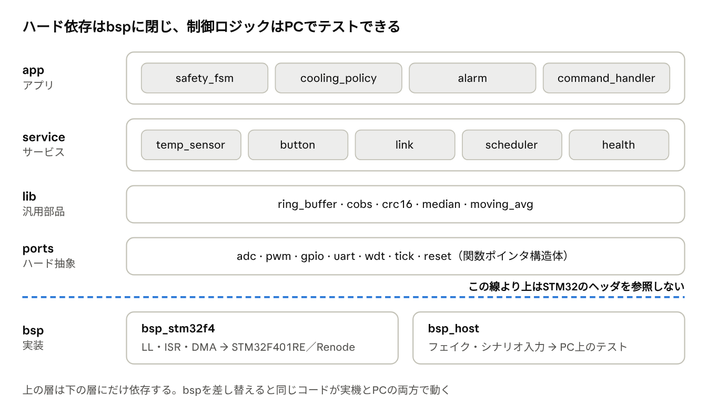

# 作品01 要件定義・基本設計書：高機能センサー制御・安全監視デバイス（C × STM32）

2026-11-21 · @io（原本：Claude Docs「作品01 要件定義・基本設計書」）

**改訂（2026-11-21）：** 共通仕様 v0.2.1（iot-common-spec タグ v0.2.1）に合わせて改訂した。UARTフレームの形・連番・コード値は iot-common-spec の docs/spec.md 第7章と uart/golden/ を正とし、契約テスト iotspec-contract --role mcu-c-01 の合格を受け入れ基準に含める。

## 1. 概要とスコープ

温度を常時監視し、異常時には上位システムがなくても単独で安全側（ファン全開・警報）に倒すマイコンファームウェアをC言語で開発する。対象はSTM32F401RE（Cortex-M4F、84MHz、Flash 512KB、RAM 96KB）、RTOSを使わないベアメタル構成とする。

ポートフォリオとして示すことは3つ。割り込みと周辺機能をレジスタレベルで理解していること。時間制約を設計で守り、測って示せること。ハード依存部を分離し、制御ロジックをPC上でテストできること。

### 前提

- プログラム先行で開発する。実機は使わず、ホスト上の単体テスト、フェイクドライバで動くホスト版ビルド、Renode（またはWokwi）で検証する

- 周辺ドライバはSTM32CubeのLL（Low Layer）を使う。HALよりレジスタ操作に近く、割り込みの流れを自分で設計できる

- 上位との通信は全体計画書の共通仕様 v0.2（UARTフレーム）に従う。デバイスIDは mcu-c-01

- 想定する周辺部品：NTCサーミスタ（10kΩ、B=3435）、25kHz PWM対応ファン（MOSFET駆動）、LED 3色、圧電ブザー、タクトスイッチ1個

<!-- -->

- PCで動く「ホスト版」を必ず作る。UARTの代わりに、引数または環境変数 IOTSPEC_UART_PATH で指定したシリアル（pty）を raw モード・115200・8N1 で開く。契約テストはこのホスト版を起動して行う（第7章）

### 対象外（本版）

- ネットワーク通信、JSON生成、絶対時刻の管理（作品03の責任）

- 低消費電力モード、Flashへのログ保存、センサー二重化（拡張で対応）

- 機能安全規格（IEC 61508等）への適合。「フェイルセーフ設計を意識した」範囲にとどめる

## 2. 機能要件

優先度はMust（MVP必須）とShould（MVPで対応、時間不足なら拡張に回す）の2段階。しきい値などの数値は初期値で、ビルド時の設定ファイルで変更できる。

| ID    | 機能             | 要件                                                                                                                                                                                                                                                                                                                                                                 | 優先度 |
|-------|------------------|----------------------------------------------------------------------------------------------------------------------------------------------------------------------------------------------------------------------------------------------------------------------------------------------------------------------------------------------------------------------|--------|
| FR-01 | 温度計測         | タイマトリガのADC＋DMAで100ms周期にサンプルし、ルックアップテーブル＋線形補間で0.01℃単位の整数値に変換する。範囲は−20〜120℃                                                                                                                                                                                                                                          | Must   |
| FR-02 | フィルタ         | 5点メディアンで外れ値を除き、8点移動平均で平滑化する                                                                                                                                                                                                                                                                                                                 | Must   |
| FR-03 | センサー故障検知 | ADC生値が断線／短絡範囲（\<50 または \>4045）を3回連続で取ったら故障と判定する。変化率が物理的にあり得ない値（5℃/100ms超）も故障候補とする                                                                                                                                                                                                                           | Must   |
| FR-04 | しきい値判定     | WARNING 45℃、CRITICAL 60℃。上昇は1秒継続で確定、下降はヒステリシス3℃で確定し、チャタリングを防ぐ                                                                                                                                                                                                                                                                     | Must   |
| FR-05 | 状態管理         | INIT／NORMAL／WARNING／CRITICAL／SENSOR_FAULTの5状態をテーブル駆動で管理する（第4章）                                                                                                                                                                                                                                                                                | Must   |
| FR-06 | 冷却制御         | 25kHz PWMでファンを駆動する。NORMALは35〜45℃で0→40%の線形、WARNINGは70%、CRITICALとSENSOR_FAULTは100%                                                                                                                                                                                                                                                                | Must   |
| FR-07 | 表示・警報       | 状態ごとにLED（点灯／1Hz点滅／4Hz点滅）とブザー（断続／連続）を切り替える                                                                                                                                                                                                                                                                                            | Must   |
| FR-08 | ボタン操作       | 10msごとのポーリングで検出し（外部割り込みは使わない。ADR-0005）、20msでチャタリングを除去する。短押しの1回目はブザー消音、2回目は承認（CRITICALは温度が crit−hyst 未満、SENSOR_FAULTは正常サンプルが10回連続のときだけ有効）。3秒長押し＝強制ファン全開のトグル                                                                                                                                                 | Must   |
| FR-09 | 上位への通知     | UARTフレームで、TELEMETRYとHEARTBEATを1秒ごと、EVENTを状態変化時、STATEを起動直後と60秒ごとに送る。連番（seq）はフレーム種別ごとに持つ                                                                                                                                                                                                                               | Must   |
| FR-10 | 指令受信         | CMDフレームで、しきい値変更・ファン手動指定・状態問い合わせを受け、必ずACKを返す。安全側を弱める指令は、ファン指定なら状態の下限に丸めて done・limited とし、CRITICAL・SENSOR_FAULT中のしきい値変更は拒否する（第8章）。拒否と失敗のACKには必ず理由（reason）を入れる。直近16件の cmd_ref と同じ指令には、再実行せず前回のACKを返す                                  | Must   |
| FR-11 | ウォッチドッグ   | 独立ウォッチドッグ（タイムアウト500ms）を使う。全タスクが周期内に生存報告したときだけリフレッシュする                                                                                                                                                                                                                                                                | Must   |
| FR-12 | 起動時処理       | INIT（最大2秒）の間に boot_id の生成、LED・ブザーの短い自己診断、フィルタの充填とADCの妥当性確認を行う。INITの間はフレームを送らず、指令も処理しない。INITを抜けるときに STATE → BOOTイベントの順に送り（第6章）、ADCが異常ならSENSOR_FAULTから始める。リセット要因はUARTで送る欄がないため（共通仕様の変更案 CR-2）、決まるまでは診断カウンタとホスト版のログに残す | Must   |
| FR-13 | 診断情報         | 稼働時間、リセット回数、受信CRCエラー数、最大ループ時間を保持する。UARTで返すフレームがないため（変更案 CR-1）、MVPでは GET_DIAG に ACK（done）だけを返し、値はホスト版のログとデバッガで確認する                                                                                                                                                                    | Should |
| FR-14 | 上位断の検知     | 上位のHEARTBEATが10秒途絶えたら手動指定を解除して自律制御に戻り、UPSTREAM_LOSTを送る。HEARTBEATが戻ったらUPSTREAM_RESTORED（code 8）を送る。起動から一度もHEARTBEATを受けていない場合も、起動から10秒でUPSTREAM_LOSTとする（最初のHEARTBEATではRESTOREDを送らない）。3秒の途絶は作品03側の判定で、作品01は何もしない                                                 | Must   |

## 3. 非機能要件と制約

| ID     | 分類             | 要件                                                                                                                         | 確認方法                                                                                                                                         |
|--------|------------------|------------------------------------------------------------------------------------------------------------------------------|--------------------------------------------------------------------------------------------------------------------------------------------------|
| NFR-01 | 応答性           | 温度が crit を超えてからファン100%まで2.5秒以内（内訳：フィルタの遅れ約1秒＋継続判定1秒＋CRITICAL確定から出力まで200ms以内） | ホスト版の仮想時間テスト、実機フェーズでGPIOトグル実測                                                                                           |
| NFR-02 | 周期精度         | 制御周期100ms、ジッター±1ms以内                                                                                              | ホスト版で周期を論理的に検証。Renodeは仮想時間での周期確認のみ（命令数ベースの近似で、物理的なジッターの証拠にはならない）。ジッターは実機で実測 |
| NFR-03 | 割り込み         | ISRの実行時間は各、20μs以内。ISR内ではフラグ設定とバッファ書き込みしかしない                                                 | コードレビュー、実機で実測                                                                                                                       |
| NFR-04 | メモリ           | 動的メモリ確保を使わない（malloc禁止）。Flash 64KB以内、RAM 16KB以内（スタック含む）                                         | リンカマップ、スタックペインティングによる最大使用量計測                                                                                         |
| NFR-05 | 数値表現         | 制御ロジックは整数・固定小数で書き、浮動小数点に依存しない                                                                   | コードレビュー                                                                                                                                   |
| NFR-06 | 移植性           | ハード依存部は bsp/ に閉じ込め（ports/ はインターフェースの定義だけ）、アプリ層・サービス層からSTM32のヘッダを参照しない     | CIでホスト版がビルドできること                                                                                                                   |
| NFR-07 | コーディング規約 | C11、MISRA C:2012の必須規則に準拠し、逸脱はADRに理由を記録する。-Wall -Wextra -Werror で警告ゼロ                             | cppcheck（MISRAアドオン）、clang-tidyをCIで実行。判定は「ツールで検査できる範囲で違反ゼロ」とし、bsp のベンダーコード（LL・CMSIS）は対象外       |
| NFR-08 | テスト品質       | アプリ層とサービス層の行カバレッジ80%以上                                                                                    | gcov＋gcovrをCIで集計                                                                                                                            |
| NFR-09 | ビルド           | CMake＋arm-none-eabi-gcc。ターゲット版とホスト版を同じソースツリーからプリセット切り替えで作る                               | GitHub Actions                                                                                                                                   |
| NFR-10 | 保守性           | 公開関数にはDoxygenコメント。各関数の循環的複雑度10以下                                                                      | lizard等で計測                                                                                                                                   |

制約：開発段階では実機を使わない。NFR-01〜03の実測による最終確認は実機フェーズで行い、それまでは設計とシミュレーションで担保する。

## 4. アーキテクチャ

5層構成とし、ハード依存は最下層のbspだけに置く。portsは関数ポインタの構造体で、起動時にbspが中身を詰めて上位層に渡す（依存性の注入）。

レイヤ構成 · 5層

制御の中心であるsafety_fsmとcooling_policyは「入力を受けて出力を返すだけ」の純粋な関数とし、ハードも時刻も直接は触らない。これにより全状態×全入力の組み合わせをPC上で網羅的にテストできる。

## 5. 状態遷移

状態は5つ。温度が下がってもCRITICALとSENSOR_FAULTは自動では解除せず、ボタンによる人の承認を求める。遷移は {現状態, 条件関数, 次状態, 遷移時アクション} の静的テーブルで定義し、上から順に評価する（先に一致した行が優先）。

（状態遷移図は 02-detailed-design.md 第4章を参照）

状態遷移 · 5状態

センサー故障の判定は他のどの条件よりも先に評価する。各状態の出力は次のとおり。

| 状態         | ファン                    | LED           | ブザー         | 受け付ける指令                                                            |
|--------------|---------------------------|---------------|----------------|---------------------------------------------------------------------------|
| INIT         | 100%                      | 3色を順に点灯 | 短く1回        | なし                                                                      |
| NORMAL       | 35〜45℃で0→40%の線形      | 緑 点灯       | 停止           | すべて                                                                    |
| WARNING      | 70%（手動で上げるのは可） | 黄 1Hz点滅    | 停止           | ファン指定は70%を下限に丸めて done・limited                               |
| CRITICAL     | 100%                      | 赤 4Hz点滅    | 断続（消音可） | しきい値変更は rejected（unsafe）。ファン指定は100%に丸めて done・limited |
| SENSOR_FAULT | 100%                      | 赤 点灯       | 連続（消音可） | しきい値変更は rejected（unsafe）。ファン指定は100%に丸めて done・limited |

## 6. モジュール設計とインターフェース

### モジュール一覧

| 層      | モジュール                                                                | 責務                                                                       | 主な公開API                                            |
|---------|---------------------------------------------------------------------------|----------------------------------------------------------------------------|--------------------------------------------------------|
| app     | safety_fsm                                                                | 状態遷移テーブルの評価と状態の保持                                         | fsm_init(), fsm_step(const fsm_input_t\*), fsm_state() |
| app     | cooling_policy                                                            | 状態と温度からファンデューティを決める（手動指定と安全側優先の合成を含む） | cooling_duty(state, temp_c100, override)               |
| app     | alarm                                                                     | LED・ブザーのパターン生成、消音状態                                        | alarm_set_state(), alarm_tick_10ms(), alarm_silence()  |
| app     | command_handler                                                           | 受信指令の検証・実行・ACK生成                                              | cmd_handle(const frame_t\*, frame_t\* ack)             |
| service | temp_sensor                                                               | ADC値→温度変換、フィルタ、故障判定                                         | temp_update(uint16_t raw), temp_get(temp_reading_t\*)  |
| service | button                                                                    | チャタリング除去、短押し／長押し判定                                       | button_tick_10ms(bool level), button_pop_event()       |
| service | link                                                                      | UARTフレームの組み立て・解析（COBS、CRC-16）、送信キュー、上位の生存監視   | link_send(type, payload, len), link_poll(frame_t\*)    |
| service | scheduler                                                                 | 1msティック駆動の協調型スケジューラ、実行時間計測                          | sched_add(task, period_ms), sched_run()                |
| service | health                                                                    | タスク生存報告の集約とウォッチドッグのリフレッシュ、診断カウンタ           | health_checkin(task_id), health_service()              |
| lib     | ring_buffer, cobs, crc16, median, moving_avg                              | 汎用データ構造と算法。ハード非依存                                         | 各モジュールの \*\_init / \*\_push / \*\_pop 等        |
| ports   | adc_port, pwm_port, gpio_port, uart_port, wdt_port, tick_port, reset_port | ハード抽象化。関数ポインタの構造体で実装を差し替える                       | 下記参照                                               |
| bsp     | bsp_stm32f4, bsp_host                                                     | portsの実装。STM32はLLと割り込みハンドラ、ホストはフェイクとシナリオ入力   | bsp_init(ports_t\*)                                    |

### ポート（ハード抽象化）の例

typedef struct {  
void (\*start)(void); /\* タイマトリガ変換を開始 \*/  
bool (\*fetch)(uint16_t \*raw); /\* DMA完了済みの最新値を取得 \*/  
} adc_port_t;  
  
typedef struct {  
void (\*set_duty_permille)(uint16_t duty); /\* 0–1000 \*/  
} pwm_port_t;  
  
typedef struct {  
size_t (\*write)(const uint8_t \*buf, size_t len); /\* 非ブロッキング、書けたバイト数 \*/  
size_t (\*read)(uint8_t \*buf, size_t cap); /\* 受信リングバッファから取り出し \*/  
} uart_port_t;  
  
typedef struct {  
const adc_port_t \*adc;  
const pwm_port_t \*fan;  
const gpio_port_t \*led, \*buzzer, \*button;  
const uart_port_t \*uart;  
const wdt_port_t \*wdt;  
const tick_port_t \*tick;  
const reset_port_t \*reset;  
} ports_t;

### タスクと周期

スーパーループ上の協調型スケジューラで動かす。各タスクの最悪実行時間の合計が1msを超えないことを設計条件とする。

| タスク       | 周期                 | 処理                                                     |
|--------------|----------------------|----------------------------------------------------------|
| task_sense   | 100ms                | ADC値の取得、temp_update、故障判定                       |
| task_control | 100ms（senseの直後） | fsm_step → cooling_duty → PWM更新、状態変化ならEVENT送信 |
| task_ui      | 10ms                 | ボタン判定、LED・ブザー更新                              |
| task_link    | 10ms                 | 受信フレームの解析と指令処理、送信キューの排出           |
| task_report  | 1s                   | TELEMETRYとHEARTBEATの送信                               |
| task_health  | 100ms                | 生存報告の確認とウォッチドッグリフレッシュ               |

### 割り込み一覧

| 割り込み                    | 優先度 | ISRの処理                                      |
|-----------------------------|--------|------------------------------------------------|
| SysTick（1ms）              | 1      | ティックカウンタの加算のみ                     |
| DMA2 Stream0（ADC転送完了） | 2      | 最新値をダブルバッファに確定し、フラグを立てる |
| USART2 RX／TX               | 3      | 1バイトをリングバッファと置き換える            |
| EXTI（ボタン）              | 4      | 使わない（2026-11-21 変更。ボタンは10msのポーリング。判定はtask_ui） |

ISRとタスクで共有する変数は volatile とし、複数ワードの読み出しは短い割り込み禁止区間で保護する。リングバッファは単一生産者・単一消費者のロックフリー実装とする。

### UARTフレームのペイロード

共通仕様 v0.2 の構造（\[種別\]\[seq\]\[長さ\]\[ペイロード\]\[CRC-16\] をCOBS符号化）に従う。リトルエンディアン。

| 種別      | 値   | 向き     | ペイロード                                                         | 送るタイミング                       |
|-----------|------|----------|--------------------------------------------------------------------|--------------------------------------|
| TELEMETRY | 0x01 | MCU→上位 | uptime_ms:u32, temp_c100:i16, quality:u8, state:u8, fan_pm:u16     | 1秒ごと                              |
| EVENT     | 0x02 | MCU→上位 | uptime_ms:u32, code:u8, severity:u8, from:u8, to:u8, temp_c100:i16 | 状態変化・異常・復旧のとき           |
| HEARTBEAT | 0x03 | 双方向   | uptime_ms:u32                                                      | 1秒ごと                              |
| STATE     | 0x04 | MCU→上位 | fw_version:u16, boot_id:u32, period_ms:u16                         | 起動直後の最初のフレームと、60秒ごと |
| CMD       | 0x10 | 上位→MCU | cmd_ref:u16, op:u8, ttl_s:u16, args:可変長                         | —                                    |
| ACK       | 0x11 | MCU→上位 | cmd_ref:u16, status:u8, reason:u8, limited:u8, applied:u16         | CMDを受けたとき                      |

- 連番（seq）は「方向・フレーム種別ごと」に持つ。16ビットで一周してよい（作品03が32ビットに広げる）

- state の番号：0 INIT、1 NORMAL、2 WARNING、3 CRITICAL、4 SENSOR_FAULT（プロファイル profiles/mcu-c-01.yaml と一致させる）

- EVENT の code：1 BOOT、2 STATE_CHANGED、3 THRESHOLD_EXCEEDED、4 THRESHOLD_CLEARED、5 SENSOR_FAULT、6 SENSOR_RECOVERED、7 UPSTREAM_LOST、8 UPSTREAM_RESTORED。severity：0 info、1 warning、2 critical（復旧コードは info）

- fw_version は上位バイト＝メジャー、下位バイト＝マイナー

CMDの op と引数：

| op               | 値   | args                                        | ttl_s                                          | 対応する汎用指令            |
|------------------|------|---------------------------------------------|------------------------------------------------|-----------------------------|
| SET_FAN_OVERRIDE | 0x01 | duty_pm:u16（0–1000）                       | リース秒数。受信時点から数え、ちょうどで切れる | set_actuator {id: fan_main} |
| CLEAR_OVERRIDE   | 0x02 | なし                                        | 0（無視）                                      | release {id: fan_main}      |
| SET_THRESHOLD    | 0x03 | warn_c100:i16, crit_c100:i16, hyst_c100:i16 | 0（無視）                                      | —（set_param は未定義）     |
| GET_STATUS       | 0x10 | なし                                        | 0（無視）                                      | get_status                  |
| GET_DIAG         | 0x11 | なし                                        | 0（無視）                                      | —                           |

ACK の値：status は 0 accepted、1 done、2 rejected、3 failed。reason は 0 なし、1 unsafe、2 invalid_arg、3 unknown_op、4 expired、5 internalで、rejected と failed では必ず0以外を入れる。applied は SET_FAN_OVERRIDE のときだけ実際に出したデューティを入れ、安全側で値を丸めたら limited を1にする。他の op では applied を0、limited を0にする。

### 再送された指令の扱い

作品03はACKが2秒以内に届かなければ、同じ cmd_ref で最大3回再送する。ACKだけが失われた場合に同じ操作を2回実行しないよう、command_handler は直近16件の cmd_ref とそのACKを静的なリングバッファに保持する。保持中の cmd_ref を受けたら、再実行せず前回のACKをそのまま返す。再起動で保持内容は消えるが、再起動後はBOOTとSTATEを送るので、作品03は未完了の指令を失敗として扱う。この挙動は単体テストの観点にも加える。

### 起動時の順序と boot_id

起動後は次の順に送る。作品03は STATE を受けるまで他のフレームを変換せずに捨てるため、順序を入れ替えると BOOT が届かない。

1.  STATE（boot_id、fw_version、period_ms）

2.  EVENT BOOT（severity info、リセット要因は診断情報で参照できるようにする）

3.  以降、TELEMETRY・HEARTBEAT を周期送信

boot_id は32ビットで、求められるのは「前回の起動と高い確率で異なること」だけ。STM32F401 には乱数生成器（RNG）がないので、次を混ぜて作る（boot_id モジュール。ハード依存部は entropy_port として ports に加える）。

- 内部温度センサーと VREFINT を32回ずつ ADC で読んだ値の下位ビット（雑音）

- 起動からこの処理までのタイマーのカウント値（クロック安定のばらつき）

- チップ固有ID（96ビット）とリセット要因

これらを CRC-32 などで混ぜて 32ビットにする。結果が0なら1にする。ホスト版は OS の乱数（getentropy）を使う。Renode では ADC の雑音が再現されず毎回同じ値になりうるので、その場合は「再起動で boot_id が変わること」の確認をホスト版で行う。

### ホスト版と契約テスト

- bsp_host の UART ポートは、引数または IOTSPEC_UART_PATH のパスを raw モード・115200・8N1 で開く。温度はシナリオファイルまたは固定値から与える

- ホスト版は実時間で動く。契約テストはこれを起動し、作品03の役（UART の上位）として HEARTBEAT・CMD を送って判定する

uv tool install "iotspec @ git+https://github.com/io0323/iot-common-spec@v0.2.1"  
iotspec-contract --role mcu-c-01 --target-cmd "./build/host/mcu_c_01 {uart}" --junit contract.xml

- 契約テストのチェック：起動順（STATE → BOOT）、ACK、重複 cmd_ref、UPSTREAM_LOST／RESTORED、符号化の一致、種別ごとの seq、変換後の Schema 適合。作品01の契約テストに MQTT ブローカーは不要

- 符号化・復号の単体テストでは、iot-common-spec を v0.2.1 で取り出し（git submodule または CI での checkout）、uart/golden/\*.json の frame を符号化して hex と一致すること、CMD の hex を復号して frame と一致することを確かめる

## 7. 異常系設計・テスト方針・未決事項

### 異常系の扱い

どの異常でも「ファンは回す側」に倒す。安全側の出力は制御ロジックと独立した経路でも確保する。

| 異常                   | 検知方法                                      | 対応                                                                                                            |
|------------------------|-----------------------------------------------|-----------------------------------------------------------------------------------------------------------------|
| センサー断線・短絡     | ADC生値の範囲外が3回連続                      | SENSOR_FAULTへ。ファン100%、ブザー連続、EVENT送信                                                               |
| センサー値の異常な跳び | 変化率5℃/100ms超                              | そのサンプルを棄却。連続3回でSENSOR_FAULT                                                                       |
| ADC変換が来ない        | 300ms以上DMA完了フラグが立たない              | SENSOR_FAULTへ。ADCを再初期化して復帰を試みる                                                                   |
| ソフトのハングアップ   | タスクの生存報告漏れ → ウォッチドッグリセット | 再起動後、リセット要因をBOOTイベントで報告。起動直後はファン100%から始める                                      |
| リセット中・書き込み中 | —                                             | ファン用MOSFETのゲートをプルアップし、マイコンが動いていない間はファンが回る回路とする（実機フェーズで確認）    |
| 受信フレームの破損     | CRC不一致、COBS復号失敗、長さ不正             | 破棄して診断カウンタを加算。ACKは返さない（上位がタイムアウトで再送）                                           |
| 送信キュー溢れ         | リングバッファ満杯                            | TELEMETRYを優先的に捨て、EVENTとACKは残す                                                                       |
| 上位との通信断         | 上位のHEARTBEATが10秒途絶                     | 手動指定を解除し自律制御を継続し、UPSTREAM_LOSTを送る。HEARTBEATが戻ったらUPSTREAM_RESTOREDを送る（FR-14）      |
| 安全側を弱める指令     | 現状態と指令内容の照合                        | ファン指定は状態の下限まで引き上げて done・limited。CRITICAL・SENSOR_FAULT中のしきい値変更は rejected（unsafe） |

### テスト方針

| レベル               | 対象                            | 手段                                                                                                                                                                           | 主な観点                                                                           |
|----------------------|---------------------------------|--------------------------------------------------------------------------------------------------------------------------------------------------------------------------------|------------------------------------------------------------------------------------|
| 単体                 | lib・service・appの各モジュール | Unity＋CMock（CMake／CTestから実行。Ceedlingは使わない）でポートをモック                                                                                                       | 変換テーブルの境界値、フィルタ、全状態×全入力の遷移、COBS／CRCの往復、指令拒否条件 |
| 結合（ホスト）       | ファームウェア全体＋bsp_host    | 温度推移のシナリオファイル（CSV）を流し、仮想時間で実行                                                                                                                        | 昇温→警報→冷却→復旧の一連、センサー断線、NFR-01の応答時間                          |
| 結合（エミュレータ） | STM32向けバイナリ               | Renode＋Robot Framework、UART出力を検証。RenodeのADCは外部トリガー未対応のため、Renode用ビルドだけタイマー割り込みからソフトウェアで変換を開始する（実機とは経路が違うと明記） | 起動・周期送信・指令とACK、ウォッチドッグリセット                                  |
| 契約                 | UARTフレーム                    | iot-common-spec （タグ v0.2.1）のゴールデンフレームで符号化・復号を照合し、CI で iotspec-contract --role mcu-c-01 をホスト版に対して実行する                                   | 作品03との解釈一致                                                                 |
| 実機（後日）         | 実機一式                        | ロジックアナライザー、テスター                                                                                                                                                 | NFR-01〜03の実測、リセット中のファン動作                                           |

### 受け入れ基準（MVP）

- [ ] FR-01〜12がすべてテスト仕様書の項目に紐付き、ホスト結合テストで合格している

- [ ] Renode上で起動からTELEMETRY送信、指令とACKまでが自動テストで通る

- [ ] NFR-04・06・07・08をCIで確認できる

<!-- -->

- [ ] ホスト版に対して iotspec-contract --role mcu-c-01（iot-common-spec v0.2.1）の全チェックが合格し、CI でも実行されている

- [ ] uart/golden/ の全件で、符号化と復号が一致する単体テストが通る

### 未決事項

- [ ] 決定（2026-11-21）：エミュレータはRenodeを主とし、Wokwiは使わない。F401のプラットフォーム定義は自作し、ADCはソフトウェア開始で代用する（第8章）

- [ ] ファンを2線式（MOSFETでPWM）とするか4線式（PWM入力付き・回転数パルス取得可）とするか。4線式なら回転数監視によるファン故障検知を要件に追加できる

- [ ] しきい値のUART経由の変更を再起動後も保持するか（保持するならFlash書き込みが必要。MVPでは保持しない案）

## 8. 実装前レビューでの決定事項（2026-11-21）

実装前のレビューで6点を決め、契約テストのコードが前提にしている挙動を要件に加えた。共通仕様で決めるべき5点は変更案 CR-1〜5 として iot-common-spec 側に切り出し、決まるまでは下の暫定対応で進める。詳細は作品01の詳細設計書を正とする。

### 決定事項

| \#  | 決定                                                                                                                                                                                  | 反映先              |
|-----|---------------------------------------------------------------------------------------------------------------------------------------------------------------------------------------|---------------------|
| 1   | WARNING・CRITICAL・SENSOR_FAULT 中のファン指定は拒否せず、状態の下限（70%／100%）に丸めて done・limited=1 を返す。rejected（unsafe）は CRITICAL・SENSOR_FAULT 中の SET_THRESHOLD だけ | FR-10、第5章、第7章 |
| 2   | ボタンの短押しは1回目で消音、2回目で承認。承認が有効なのは、CRITICAL では温度が crit−hyst 未満、SENSOR_FAULT では正常サンプルが10回続いたあと                                         | FR-08               |
| 3   | NFR-01 に、しきい値を超えてからファン100%までの上限2.5秒を加える。ホスト版の仮想時間で検証する                                                                                        | NFR-01              |
| 4   | 共通仕様の穴は CR-1〜5 として切り出す。GET_DIAG は ACK（done）だけ、リセット要因は診断カウンタとホスト版のログに残す                                                                  | FR-12、FR-13        |
| 5   | Ceedling は使わず、CMake＋CTest＋Unity／CMock に一本化する                                                                                                                            | 第7章               |
| 6   | Renode を主とし Wokwi は使わない。F401 のプラットフォーム定義は自作し、ADC は Renode 用ビルドだけソフトウェア開始で代用する                                                           | 第7章               |

### 契約テストが前提にしている挙動（要件に追加）

- GET_STATUS には ACK（done）と STATE の両方を返す

- ACK は accepted を使わず、done／rejected／failed をその場で返す

- ホスト版の既定の温度は25℃（35℃未満）とする。契約テストは NORMAL で SET_FAN_OVERRIDE 400・200 がそのまま done・applied になることを期待する

- TELEMETRY の fan_pm には実際の出力を入れる

- センサー故障時の temp_c100 は −32768 とする（ゴールデン18・20）

- 起動後の最初のフレームは STATE とし、HEARTBEAT も先に出さない。INIT 中に受けた CMD は処理せず、ACK も返さない（STATE 前の ACK は作品03が破棄するため）

- SIGTERM と UART の EOF を受けたら正常に終了する

### 指令の検証（CR-4 が決まるまでの暫定を含む）

- SET_FAN_OVERRIDE：duty_pm は 0〜1000、ttl_s は 1〜600。範囲外は rejected（invalid_arg）

- SET_THRESHOLD：−20.00℃ ≦ warn \< crit ≦ 80.00℃、hyst は 0.50〜10.00℃、crit−warn ≧ hyst。範囲外は rejected（invalid_arg）。再起動で既定値に戻る

- 引数の長さが違う指令は rejected（invalid_arg）、知らない op は rejected（unknown_op）。作品01は expired を返さない

### 状態遷移で送る EVENT（CR-5 が決まるまでの暫定）

1回の遷移で送る EVENT は1件だけとする。from・to には遷移の前後の状態番号を入れる。

| 遷移                                                   | code                                 | severity                                                                 |
|--------------------------------------------------------|--------------------------------------|--------------------------------------------------------------------------|
| NORMAL → WARNING                                       | 3 THRESHOLD_EXCEEDED                 | warning                                                                  |
| NORMAL・WARNING → CRITICAL                             | 3 THRESHOLD_EXCEEDED                 | critical                                                                 |
| WARNING → NORMAL、CRITICAL → WARNING・NORMAL（承認後） | 4 THRESHOLD_CLEARED                  | info                                                                     |
| 任意の状態 → SENSOR_FAULT                              | 5 SENSOR_FAULT                       | critical                                                                 |
| SENSOR_FAULT → 他の状態（承認後）                      | 6 SENSOR_RECOVERED                   | info                                                                     |
| INIT → NORMAL・WARNING・CRITICAL                       | 2 STATE_CHANGED                      | 遷移先に従う（NORMAL は info、WARNING は warning、CRITICAL は critical） |
| 起動（INIT を抜けるとき、STATE の直後）                | 1 BOOT                               | info（from・to は 0）                                                    |
| 上位断・復帰                                           | 7 UPSTREAM_LOST／8 UPSTREAM_RESTORED | warning／info（from・to は現在の状態）                                   |
