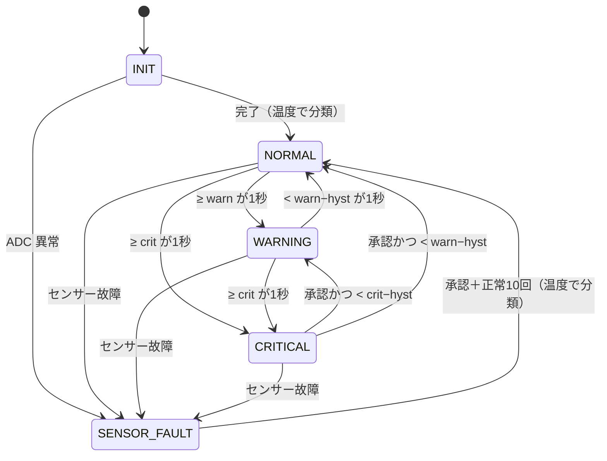

# 作品01 詳細設計書：高機能センサー制御・安全監視デバイス（C × STM32）

2026-11-21 · @io（原本：Claude Docs「作品01 詳細設計書」）

要件定義・基本設計書（第8章の決定を含む）を実装できる粒度まで落とした書類。数値・型・順序はこの書類を正とし、UART の形とコード値は iot-common-spec v0.2.1 を正とする。ここにないことは実装で決めず、docs/open-questions.md に記録する。

## 1. リポジトリとビルド

リポジトリ名は **`iot-thermal-guard-stm32`** を推奨する。先頭の `iot-` で iot-common-spec とシリーズを揃え、何をするものか（温度の安全監視）と対象（STM32）が名前で分かる。候補はほかに `mcu-c-01-safety-monitor`（device\_id と一致）と `stm32-safety-monitor`。リポジトリ名を変えても、device\_id（`mcu-c-01`）とホスト版の実行ファイル名（`mcu_c_01`）は契約テストに合わせて固定する。

### ディレクトリ構成

```text
iot-thermal-guard-stm32/
├── CMakeLists.txt / CMakePresets.json
├── cmake/                     # arm-none-eabi のツールチェーン、警告オプション
├── app/                       # safety_fsm, cooling_policy, alarm, command_handler, event_map
├── service/                   # temp_sensor, button, link, upstream, scheduler, health, boot_id, diag
├── lib/                       # ring_buffer, cobs, crc16, crc32, median, moving_avg, ntc_table
├── ports/                     # ports.h（関数ポインタの構造体だけ。実装なし）
├── bsp/
│   ├── host/                  # pty、実時間の tick、CLI、シナリオ、ログ、疑似ウォッチドッグ
│   └── stm32f4/               # LL、割り込み、起動コード、リンカスクリプト、pinmap.h
├── main/                      # firmware.c（タスクの登録と配線。両方の bsp で共通）
├── tests/
│   ├── unit/                  # Unity＋CMock（モジュールごと）
│   ├── golden/                # ゴールデンの符号化・復号
│   ├── scenario/              # 仮想時間の結合テスト（sim_harness と CSV）
│   └── renode/                # Robot Framework
├── renode/                    # nucleo_f401re.repl、.resc
├── tools/                     # gen_golden_vectors.py、gen_ntc_table.py、check_size.py
├── third_party/               # unity、cmock、cmsis_core、cmsis_device_f4、stm32f4xx_hal_driver（submodule）
├── external/iot-common-spec/  # submodule。タグ v0.2.1 に固定
├── docs/                      # open-questions.md、test-spec.md、adr/
├── CLAUDE.md / README.md
└── .github/workflows/ci.yml
```

依存の向きは app → service → lib、app・service → ports の一方向だけとする。bsp だけが ports を実装し、STM32 のヘッダを include できる。CMake では層ごとにライブラリを分け、逆向きのリンクを作らないことで依存を強制する。

### CMake プリセット

| プリセット | 出力先 | 内容 | 使うフェーズ |
| --- | --- | --- | --- |
| `host-debug` | `build/host` | ホスト版＋全テスト。ASan・UBSan あり。契約テストは `build/host/mcu_c_01` を起動する | P1〜 |
| `host-coverage` | `build/host-cov` | gcov 付き。gcovr で app・service の行カバレッジを集計 | P4〜 |
| `target-debug`／`target-release` | `build/target` | arm-none-eabi-gcc、`-Og`／`-Os`。.elf・.bin・.map | P5〜 |
| `target-renode` | `build/renode` | target と同じソースに `ADC_SOFTWARE_START=1`（Renode 用の ADC 開始方法） | P6〜 |

### コンパイルオプション（共通）

- `-std=c11 -Wall -Wextra -Werror -Wconversion -Wsign-conversion -Wshadow -Wstrict-prototypes -Wcast-align -Wswitch-enum -fno-common`
- ホスト版には `-funsigned-char` を付け、ARM と char の符号を揃える。データには素の char を使わず `uint8_t` を使う
- 動的メモリと浮動小数点は app・service・lib で禁止する。`malloc`・`float`・`double` の使用を CI の grep で検出する（bsp\_host の CLI 解析だけ例外）
- ターゲット版は `-mcpu=cortex-m4 -mthumb -mfloat-abi=hard -mfpu=fpv4-sp-d16 -ffunction-sections -fdata-sections -fstack-usage`、リンクは `--gc-sections`

## 2. ポートと時間

時間はすべて `tick_port` のミリ秒で扱う。ホスト版は実時間（CLOCK\_MONOTONIC）、シナリオテストは仮想時間、1つのバイナリで両方を切り替えることはしない。uptime\_ms は u32 で約49.7日で一周するので、時刻の比較は必ず `(int32_t)(now - t) >= 0` の形で書く。実際のコードでは lib/tick.h の tick\_reached(now, deadline)（符号なしの差が 0x80000000 未満なら真）だけを使い、符号付きへのキャストを各所に書かない（MISRA 10.8 の逸脱を作らないため）。

### ports.h

```c
typedef struct { uint32_t (*now_ms)(void); uint32_t (*cycles)(void); } tick_port_t;   /* cycles: 実機は DWT、ホストは ns */
typedef struct { bool (*take_sample)(uint16_t *raw); void (*restart)(void); } adc_port_t; /* 100ms ごとに1値 */
typedef struct { void (*set_duty_pm)(uint16_t pm); } pwm_port_t;                        /* 0–1000 ‰ */
typedef enum { LED_GREEN, LED_YELLOW, LED_RED } led_t;
typedef struct { void (*set_led)(led_t led, bool on); void (*set_buzzer)(bool on);
                 bool (*button_pressed)(void); } gpio_port_t;
typedef struct { size_t (*read)(uint8_t *buf, size_t cap); size_t (*write)(const uint8_t *buf, size_t len); } uart_port_t;
typedef struct { void (*refresh)(void); } wdt_port_t;
typedef enum { RESET_UNKNOWN, RESET_POWER_ON, RESET_PIN, RESET_WATCHDOG, RESET_SOFTWARE,
               RESET_BROWNOUT, RESET_LOW_POWER } reset_reason_t;   /* CR-2 の値と同じ順 */
typedef struct { reset_reason_t (*reason)(void); uint16_t (*count)(void); void (*system_reset)(void); } reset_port_t;
typedef struct { size_t (*gather)(uint8_t *buf, size_t cap); } entropy_port_t;
typedef struct { const tick_port_t *tick; const adc_port_t *adc; const pwm_port_t *pwm; const gpio_port_t *gpio;
                 const uart_port_t *uart; const wdt_port_t *wdt; const reset_port_t *reset;
                 const entropy_port_t *entropy; } ports_t;
void bsp_init(ports_t *out);   /* bsp_host と bsp_stm32f4 がそれぞれ実装する */
```

### スケジューラ

- タスクは静的な表で登録する。`sched_run()` は各タスクについて `now - next >= 0` なら実行し、`next += period` とする（`now + period` にすると周期がずれていく）。遅れて `next` が過去になった場合は追いつくまで実行せず、1回だけ実行してオーバーランを数える
- 各タスクの実行時間を `cycles()` で測り、最大値を診断値に残す。ループ1周の最大値も同じく残す
- 同じミリ秒に複数のタスクが来たら、表の順に実行する。表の順は sense → control → link → ui → report → health。control は sense と同じ位相で登録し、必ずその直後に動く
- report は INIT を抜けた時刻を起点に1秒ごと、STATE は最後に STATE を送った時刻から60秒ごと。GET\_STATUS で送った STATE は60秒の起点を動かさない

### 起動の順序

1. `bsp_init()` でポートを用意する。ファンはこの時点で100%
2. リセット要因とリセット回数を読む（診断値に残す）
3. entropy を集めて boot\_id を作る（第7章）
4. INIT：LED を 赤→黄→緑 の順に100msずつ点灯し、ブザーを100ms鳴らす。並行して温度サンプルを集め、フィルタが満たされるまで待つ（ready になる12サンプル目（約1.1秒）で抜ける。最長2秒で、それまでに ready にならなければ SENSOR_FAULT）。この間はフレームを送らず、受信した CMD は捨てて数える。HEARTBEAT は受け付け、上位監視を改める
5. INIT を抜ける：STATE → EVENT BOOT → 遷移の EVENT（STATE\_CHANGED または SENSOR\_FAULT）の順に送る。以降は周期送信と指令処理を始める

### タスクと予算

| タスク | 周期 | 処理 | 最悪実行時間の予算 |
| --- | --- | --- | --- |
| task\_sense | 100ms | ADC の値を取り、temp\_sensor を更新 | 100μs |
| task\_control | 100ms | fsm\_step → cooling\_duty → PWM、EVENT を送信キューへ | 100μs |
| task\_link | 10ms | 受信フレームの解析と指令処理、リースの期限、上位監視、送信 | 300μs |
| task\_ui | 10ms | ボタン、LED・ブザー | 50μs |
| task\_report | 1s | TELEMETRY → HEARTBEAT、60秒ごとに STATE | 100μs |
| task\_health | 100ms | 生存報告の確認とウォッチドッグ | 20μs |

予算の合計は670μs で、1ms の設計条件に収まる。値は予算であり実測ではない。実機フェーズで DWT の最大値と照合する。

## 3. 温度計測

温度は100msごとに1値を得て、変換 → メディアン5点 → 変化率の検査 → 移動平均8点 の順に通す。故障判定は変換より前の生値で行う。すべて整数で、温度は 0.01℃ 単位の `int16_t`（temp\_c100）とする。0.01℃ は表現の単位であり、精度ではない。

### 回路の前提（ADR-0001 に記録）

3.3V → 10kΩ（1%）プルアップ → ADC 入力 → NTC（10kΩ、B=3435）→ GND。ADC は12ビット、3.3V 基準のレシオメトリック。この構成では温度が上がるほど生値が下がる。

| 温度 | NTC の抵抗（概算） | ADC の生値（概算） |
| --- | --- | --- |
| −20℃（測定範囲の下端） | 77.5kΩ | 3627 |
| 25℃ | 10.0kΩ | 2048 |
| 120℃（測定範囲の上端） | 0.62kΩ | 238 |

値は B 定数の式による概算で、変換表は `tools/gen_ntc_table.py` が同じ式から生成する。実機フェーズで実測して表を置き換えられるように、表は生成物として扱い手で編集しない。生値の式は round(4095 × R ÷ (R + 10kΩ))（ホスト版の温度→生値も同じ式）。補間と移動平均の整数は四捨五入（負の値は 0 を中心に対称）。

### 取得

- 実機：TIM2 の TRGO（100Hz）で ADC1 を起動し、DMA2 Stream0 で循環バッファ20語に転送する。半分転送と全転送の割り込み（どちらも100msごと）で「空いた方の10語」を確定させ、タスク側で平均して1値にする
- Renode：TIM2 の更新割り込みでソフトウェア開始する（`ADC_SOFTWARE_START=1`。転送と平均は共通）
- ホスト：シナリオの温度（℃）を bsp\_host が上の式で生値に戻して渡す。浮動小数点は bsp\_host の中だけで使う

### 判定とフィルタ

| 段 | 条件 | 処理 |
| --- | --- | --- |
| 故障（短絡・断線） | 生値 < 50 または > 4045 が3回連続 | 故障（原因：short／open） |
| 範囲外（故障ではない） | 50〜237 または 3628〜4045 | 120.00℃／−20.00℃ に丸めて使う。診断値 `temp_clamped` を数える |
| 変換 | — | 1℃刻みの表（−20〜120℃、141点）を二分探索し、線形補間 |
| メディアン | 5点 | 外れ値を除く |
| 変化率 | 前回採用した値との差が 5.00℃ 超 | そのサンプルを棄却（前回値を保持）。3回連続で故障（原因：rate） |
| 移動平均 | 8点 | 平滑化。出力が temp\_c100 |
| ADC 無応答 | 300ms 新しい値が来ない | 故障（原因：adc\_timeout）。続く間、1秒ごとに `adc->restart()` |

- 準備完了（ready）：メディアンと移動平均が満たされる12サンプル目（1.2秒）から。故障に入ったらフィルタを空にし、故障が消えてから改めて12サンプルを待つ
- 正常の連続回数（valid\_run）：ready で故障条件がないサンプルごとに1つ増やす（255 で止める）。SENSOR\_FAULT の解除に使う
- 故障中の temp\_c100 は −32768、quality は 2（fault）。それ以外は quality 0（good）。作品01は quality 1（stale）を使わない

```c
typedef enum { TEMP_FAULT_NONE, TEMP_FAULT_SHORT, TEMP_FAULT_OPEN, TEMP_FAULT_RATE, TEMP_FAULT_ADC_TIMEOUT } temp_fault_t;
typedef struct { int16_t temp_c100; uint8_t quality; bool ready; temp_fault_t fault; uint8_t valid_run; } temp_reading_t;
void temp_update(uint16_t raw, uint32_t now_ms);   /* 値が来たとき */
void temp_tick(uint32_t now_ms);                   /* 無応答の検出。task_sense が毎回呼ぶ */
void temp_get(temp_reading_t *out);
```

応答の見積もり（NFR-01）：階段状の温度変化がメディアンを通るのに最大300ms、移動平均がしきい値を超えるまで最大800ms、継続判定が1秒、制御周期が100ms で、合計は最大2.2秒。上限2.5秒に収まることを仮想時間シナリオで確かめる。

## 4. 状態遷移

`fsm_step()` は100msごとに呼ばれる純粋な関数で、温度・承認・しきい値を受けて次の状態と送る EVENT を返す。時刻は持たず、「1秒継続」は「条件を満たすサンプルが10回連続」として数える。遷移表は上から順に評価し、最初に一致した行を使う。



温度が下がるだけで戻れるのは WARNING → NORMAL だけで、CRITICAL と SENSOR\_FAULT は承認を待つ。どの状態からでもセンサー故障が最優先である。

| # | 現状態 | 条件 | 次の状態 | EVENT（code・severity） |
| --- | --- | --- | --- | --- |
| 1 | INIT | 準備完了、かつ温度が故障（または2秒で ready にならない） | SENSOR\_FAULT | 5 SENSOR\_FAULT・critical |
| 2 | INIT | 準備完了 | 分類(t) | 2 STATE\_CHANGED・遷移先に従う |
| 3 | NORMAL・WARNING・CRITICAL | 温度が故障 | SENSOR\_FAULT | 5 SENSOR\_FAULT・critical |
| 4 | SENSOR\_FAULT | 承認、かつ valid\_run ≧ 10 | 分類(t) | 6 SENSOR\_RECOVERED・info |
| 5 | NORMAL・WARNING | t ≧ crit が10回連続 | CRITICAL | 3 THRESHOLD\_EXCEEDED・critical |
| 6 | NORMAL | t ≧ warn が10回連続 | WARNING | 3 THRESHOLD\_EXCEEDED・warning |
| 7 | WARNING | t < warn−hyst が10回連続 | NORMAL | 4 THRESHOLD\_CLEARED・info |
| 8 | CRITICAL | 承認、かつ t < crit−hyst | t ≧ warn−hyst なら WARNING、それ以外は NORMAL | 4 THRESHOLD\_CLEARED・info |
| 9 | どれでも | 上のどれにも当たらない | 変わらない | なし |

- 分類(t)：t ≧ crit なら CRITICAL、t ≧ warn なら WARNING、それ以外は NORMAL。INIT の出口と故障からの復帰では、フィルタがすでに1.2秒分の値を持っているので継続判定を待たない
- 承認はボタンからの1回限りの入力で、当たった行がなくてもそのステップで消費する（保留しない）
- 連続回数のカウンタ（t ≧ warn、t ≧ crit、t < warn−hyst の3つ）は状態に関係なく毎ステップ数え、条件が崩れたときと温度が故障のときだけ 0 に戻す。状態が変わっても戻さない（NORMAL → WARNING で crit のカウントがやり直しになると、急な昇温で CRITICAL が最大1秒遅れるため）。しきい値の変更は次のステップから効き、カウンタはそのまま
- 既定値：warn 45.00℃、crit 60.00℃、hyst 3.00℃（`config/thresholds.h`、ビルド時に変更可）

```c
typedef enum { ST_INIT = 0, ST_NORMAL = 1, ST_WARNING = 2, ST_CRITICAL = 3, ST_SENSOR_FAULT = 4 } fsm_state_t;
typedef struct { temp_reading_t temp; bool init_done; bool ack; int16_t warn_c100, crit_c100, hyst_c100; } fsm_input_t;
typedef struct { fsm_state_t from, to; bool changed; uint8_t event_code; uint8_t severity; } fsm_output_t;
void fsm_init(fsm_ctx_t *ctx);
void fsm_step(fsm_ctx_t *ctx, const fsm_input_t *in, fsm_output_t *out);
```

## 5. 出力の決定（冷却・警報・ボタン）

ファンの出力は「要求された値」「状態の下限」「ローカルの強制全開」の最大値とし、安全側を弱める指定は拒否せず下限に丸める（設計書第8章の決定1）。

### 冷却（cooling\_policy）

```text
base   = 手動指定が有効 ? 指定値 : auto(t)
floor  = INIT 1000 ／ NORMAL 0 ／ WARNING 700 ／ CRITICAL 1000 ／ SENSOR_FAULT 1000
duty   = max(base, floor, 強制全開 ? 1000 : 0)          単位は ‰（0–1000）
auto(t)= t < 35.00℃ → 0、 35.00〜45.00℃ → (t − 3500) × 400 ÷ 1000、 t ≧ 45.00℃ → 400（整数、切り捨て）
```

- SET\_FAN\_OVERRIDE を受けたときの ACK は、`applied` = その時点の duty、`limited` = (指定値 < duty) とする。リースの途中で状態が上がって引き上げられても、ACK は送り直さない（CR-3 が決まれば INTERLOCK\_ACTIVE で知らせる）
- duty が変わったら即座に `pwm->set_duty_pm()` を呼ぶ。再計算は task\_control（100ms）に加え、指令の適用・リースの期限・強制全開の切替・状態の変化のたびに行う
- TELEMETRY の fan\_pm は最後に PWM へ書いた duty とする
- 実機：TIM3 CH1、タイマークロック84MHz、PSC 0、ARR 3359 で 25kHz。CCR = duty × 3360 ÷ 1000

### 警報（alarm、10ms ごと）

| 状態 | LED | ブザー | 消音 |
| --- | --- | --- | --- |
| INIT | 赤→黄→緑 を100msずつ、以降は3色消灯 | 最初の100msだけ | — |
| NORMAL | 緑 点灯 | なし | — |
| WARNING | 黄 1Hz（500ms点灯／500ms消灯） | なし | — |
| CRITICAL | 赤 4Hz（125ms／125ms） | 断続（250ms鳴動／250ms停止） | 可 |
| SENSOR\_FAULT | 赤 点灯 | 連続 | 可 |

消音は CRITICAL または SENSOR\_FAULT に新しく入ったときに解除する。点滅の位相は状態に入った時刻を起点にする。強制全開中は、状態の表示に加えて緑を 2Hz で点滅させる（NORMAL の場合）。

### ボタン（button、10ms ごと）

- EXTI は「押されたかもしれない」フラグだけを立てる。判定は task\_ui が `button_pressed()` を 10ms ごとに読んで行う
- チャタリング除去：同じレベルが2回（20ms）続いたら確定
- 短押し：押してから3秒未満で離したとき。長押し：押し続けて3秒に達した時点（離すのを待たない）。長押しの後に離しても短押しにはしない
- 短押しの意味：ブザーが鳴っていて消音していなければ（CRITICAL・SENSOR\_FAULT で消音していない間。断続の音が止まっている瞬間も含む）「消音」、それ以外は「承認」として次の fsm\_step に1回だけ渡す
- 長押し：強制全開を切り替える。強制全開は再起動で解除され、上位断では解除しない（ローカルの操作なので）
- 実機：Nucleo の B1（PC13、押すと Low）を使う。ピンは `bsp/stm32f4/pinmap.h` に集約し、LED・ブザー・ファンのピンも P5 でそこに確定する

## 6. UART リンクと指令処理

フレームの形とコード値は iot-common-spec v0.2.1 の第7章とゴールデンに従う。この章は、仕様が決めていない作品01の内側（キュー、順序、検証、記憶）を定める。

### フレームの符号化と復号（lib と service/link）

- `[type u8][seq u16 LE][len u8][payload][crc u16 LE]` を COBS で符号化し、末尾に 0x00。CRC-16/CCITT-FALSE（多項式 0x1021、初期値 0xFFFF、反転なし、XOR なし）を type から payload 末尾までにかける
- ペイロードは構造体を memcpy せず、`put_u16le()` などで項目ごとに詰める。送るフレームの最大は生の16バイト（TELEMETRY・EVENT）、符号化後18バイト
- 復号の失敗は理由ごとに数える：cobs\_error、length\_mismatch（len と実際の長さが違う）、crc\_mismatch、unexpected\_type（作品01が受けるのは HEARTBEAT と CMD だけ）、rx\_overflow。どれも ACK を返さず破棄する

### 受信

- 実機：USART2（PA2・PA3、ST-LINK の仮想 COM）の RXNE 割り込みで、1バイトずつ256バイトのリングバッファに入れる（単一生産者・単一消費者、ロックなし）。満杯なら捨てて rx\_overflow を数える
- task\_link が 0x00 までを224バイトのフレームバッファにため、復号する。バッファがあふれたら次の 0x00 まで捨てる
- 受信時刻は「0x00 を取り出した task\_link の実行時刻」とし、リースと上位監視の起点に使う（誤差は10ms以内）

### 送信

- 送信キューは16枚の枠で、枠には符号化前の種別とペイロードを入れる。seq は「符号化して送り出すとき」に種別ごとのカウンタから割り当てる。このためキューで捨てたフレームは seq に欠番を作らず、契約テスト `seq_per_type` と矛盾しない。捨てた件数は診断値 tx\_dropped に残す
- 満杯のとき：TELEMETRY・HEARTBEAT はそのまま捨てる。STATE・EVENT・ACK はキュー内で最も古い TELEMETRY または HEARTBEAT を押し出して入る。押し出せるものがなければ捨てる。それ以外の順序は入れた順（FIFO）
- 実機は TXE 割り込みで128バイトの送信リングから送る。task\_link はリングに1フレーム分の空きがあるときだけ符号化して移す。ホストはノンブロッキングの write
- 1秒あたりの送信量は TELEMETRY・HEARTBEAT で約30バイトで、115200bps（約11.5kB/s）に対して十分に小さい

### 上位監視（service/upstream）

| 状態 | HEARTBEAT を受けた | 最後の受信（未受信なら起動時刻）から10秒 |
| --- | --- | --- |
| UNKNOWN（起動直後） | ALIVE。EVENT なし | LOST。手動指定を解除し UPSTREAM\_LOST |
| ALIVE | 時刻を更新 | LOST。手動指定を解除し UPSTREAM\_LOST |
| LOST | ALIVE。UPSTREAM\_RESTORED | 何もしない |

どちらの EVENT も INIT 中には送らず、INIT を抜けたときに状態を評価し直す。判定は task\_link（10ms）で行う。

### 指令処理（command\_handler）

処理の順序：① INIT 中なら捨てる（ACK なし） → ② 重複キャッシュに cmd\_ref があれば、前回と同じ ACK を新しい seq で返して終わる → ③ 検証と実行 → ④ 結果をキャッシュに入れて ACK を送る。rejected の結果もキャッシュする。

| op | 引数の長さ | 検証 | 成功時 |
| --- | --- | --- | --- |
| SET\_FAN\_OVERRIDE 0x01 | 2 | duty\_pm 0–1000、ttl\_s 1–600。範囲外は invalid\_arg | 手動指定を置き換え、期限 = 受信時刻 + ttl\_s × 1000。done、applied・limited は第5章 |
| CLEAR\_OVERRIDE 0x02 | 0 | — | 手動指定を解除（なくても成功）。done |
| SET\_THRESHOLD 0x03 | 6 | CRITICAL・SENSOR\_FAULT 中は unsafe。−20.00℃ ≦ warn < crit ≦ 80.00℃、50 ≦ hyst ≦ 1000、crit−warn ≧ hyst。外れたら invalid\_arg | しきい値を置き換え。done（再起動で既定値に戻る） |
| GET\_STATUS 0x10 | 0 | — | STATE を送り、続けて ACK（done）を送る（STATE 待ちの作品03は ACK を捨てるため、STATE を先にする）。重複した GET\_STATUS にも STATE を送り直す（読み出しで副作用がないため） |
| GET\_DIAG 0x11 | 0 | — | ACK（done）だけ（CR-1 待ち） |
| それ以外 | — | — | rejected（unknown\_op） |

- 引数の長さが表と違えば rejected（invalid\_arg）。applied と limited は SET\_FAN\_OVERRIDE 以外では 0。rejected・failed では reason を必ず入れる
- ACK を送信キューに入れられないときは、実際の実行結果をそのまま重複キャッシュに残し、tx\_dropped を数える（作品03の再送で正しい ACK が届く）。failed（internal）は現時点で使う場面がない。expired は返さない（CR-4）
- 重複キャッシュ：16件の静的な配列（cmd\_ref、status、reason、limited、applied）。古いものから上書き。重複による再送はリースを延長しない
- リースの期限は task\_link が10msごとに `now - expires >= 0` で判定し、切れたら手動指定を解除して出力を再計算する。上位断（LOST）でも解除する

## 7. ヘルス・リセット・boot\_id・診断

### ウォッチドッグ（health）

- 各タスクは実行の最後に `health_checkin(task_id)` で自分のビットを立てる
- task\_health（100ms）は、周期が100ms以下のタスク（sense、control、link、ui）が全員ビットを立てていて、report の最後の実行（まだなければ INIT を抜けた時刻）から1.5秒以内のときだけ `wdt->refresh()` を呼び、ビットを消す
- 実機：IWDG、LSI（公称32kHz）を 1/32 に分周、リロード値 500 で500ms。LSI は個体差が大きく、実際の時間はおよそ340〜940ms の幅を持つ。100ms ごとのリフレッシュは最短側でも間に合う
- INIT の間は起動処理が直接リフレッシュする（INIT は最長2秒で、その間もループは回っている）

### リセット要因と回数

- 実機：RCC\_CSR のフラグ（PORRST、PINRST、IWDGRST、SFTRST、BORRST、LPWRRST）を読んで `reset_reason_t` にし、RMVF で消す。複数立っていれば IWDG → ソフトウェア → BOR → 低電力 → 電源投入 → ピン の順に優先する（電源投入ではピンも立つため）
- リセット回数は `.noinit` 領域にマジック値と一緒に置き、電源投入では 0 から数え直す
- ホスト：疑似ウォッチドッグが500ms リフレッシュされないと、環境変数 `MCU_C_01_RESET_REASON=watchdog` と回数を付けて自分自身を `execv()` で起動し直す。開いている UART のパスは引数でそのまま渡す
- リセット要因は CR-2 が決まるまで UART では送らず、診断値とホスト版のログに残す

### boot\_id

- 実機：ADC をソフトウェア開始で使い、内部温度センサーと VREFINT を32回ずつ読んだ値（各下位4ビット）、DWT のサイクル数、チップ固有 ID（96ビット）、RCC\_CSR を並べ、CRC-32（IEEE、lib/crc32）で 32 ビットにする。結果が 0 なら 1
- ホスト：`getentropy()` で4バイト。同じく 0 なら 1
- 確かめることは「再起動で boot\_id が変わる」ことだけ。ホスト版の疑似ウォッチドッグリセットで確かめる（Renode では ADC の雑音がないため確かめない）

### 診断値（diag）

| 項目 | 型 | 内容 |
| --- | --- | --- |
| reset\_reason・reset\_count | u8・u16 | 起動時に確定 |
| rx\_cobs\_errors・rx\_len\_errors・rx\_crc\_errors・rx\_unexpected・rx\_overflow | u16 | 受信で捨てた理由別の件数 |
| cmd\_dropped\_init・cmd\_duplicates | u16 | INIT 中に捨てた CMD、重複として前回の ACK を返した件数 |
| tx\_dropped | u16 | 送信キューで捨てた件数 |
| temp\_clamped・temp\_rejected | u16 | 範囲外で丸めた、変化率で棄却した件数 |
| max\_loop\_cycles・max\_task\_cycles\[6\]・overruns | u32・u32・u16 | スケジューラの計測（NFR-02・03 の実機測定に使う） |

カウンタは飽和させ、一周させない。ホスト版は終了時と SIGUSR1 を受けたときにログへ書き出す。

## 8. ホスト版（bsp\_host）

ホスト版は「実時間で動く実機の代わり」で、契約テストと手動の確認に使う。仮想時間の結合テストはこのバイナリではなく、第9章の sim\_harness で行う。スレッドは使わず、`poll()` を使う 1 スレッドのループで、実機の割り込みにあたる処理（バイトの受信、ADC の値、ボタン）をループの決まった位置で呼ぶ。

### 使い方

```text
mcu_c_01 [--temp <℃>] [--scenario <file.csv>] [--log <file.jsonl>] [UART_PATH]
```

| 引数 | 既定 | 内容 |
| --- | --- | --- |
| `UART_PATH` | 環境変数 `IOTSPEC_UART_PATH` | 開くシリアル。両方あれば引数を優先。どちらもなければ終了コード 2 |
| `--temp` | 25.0 | 固定の温度。契約テストはこの既定値（NORMAL、35℃未満）を前提にする |
| `--scenario` | なし | CSV の時系列。`--temp` より優先 |
| `--log` | 標準エラー | JSON Lines のログの出力先 |

- 開き方：`O_RDWR | O_NOCTTY | O_NONBLOCK`、`cfmakeraw()`、115200・8N1・フロー制御なし、`CLOCAL | CREAD`。pty でボーレートの設定が失敗しても続行する
- 終了：SIGTERM・SIGINT で終了コード 0。read が 0 または EIO を返したら（相手が pty を閉じた）終了コード 0。どちらも終了前に診断値をログに書く
- 時間：`clock_gettime(CLOCK_MONOTONIC)` のミリ秒。`cycles()` はナノ秒を返す

### シナリオ（CSV）

`t_ms,temp_c,event` の3列。温度は次の行まで線形につなぐ。event は空か次のどれかで、同じ形式を第9章の仮想時間テストも使う。

| event | 意味 |
| --- | --- |
| `button_down`／`button_up` | ボタンのレベル。短押し・長押しは間隔で表す |
| `sensor_open`／`sensor_short`／`sensor_ok` | ADC の生値を 4095／0 に固定、または温度からの値に戻す |
| `adc_stall`／`adc_resume` | ADC の値を出さない／再開する |
| `hang` | ファームウェアのループを止める（無限ループの模擬。疑似ウォッチドッグの監視だけは続ける） |

### ログ（JSON Lines）

1行1件で、すべて `t_ms` と `kind` を持つ。kind は `boot`（boot\_id・reset\_reason）、`state`、`fan`（pm）、`led`、`buzzer`、`tx`・`rx`（種別、seq、項目、生の16進）、`rx_error`（理由）、`diag`。契約テストが落ちたときは、このログと契約テストの JUnit を CI の成果物として残す。

## 9. テストと CI

テストは5段で、上の3段（単体・ゴールデン・仮想時間シナリオ）は CTest で一度に動く。時間に関わる要件は仮想時間で論理的に確かめ、実時間には契約テストだけを使う。

| 段 | 対象 | 手段 | 主な観点 |
| --- | --- | --- | --- |
| 単体 | lib・service・app の各モジュール | Unity＋CMock。ポートはモック | COBS・CRC の往復、変換表の境界、フィルタ、遷移表の全行（状態×入力の全組合せ）、指令の全検証条件、重複キャッシュの押し出し、送信キューの満杯 |
| ゴールデン | フレームの符号化・復号 | iot-common-spec v0.2.1 の `uart/golden/*.json` から生成したテストベクタ | 下記 |
| 仮想時間シナリオ | app＋service＋フェイクのポート | `tests/scenario/sim_harness`（1ms ずつ時間を進める）＋CSV | NFR-01 の2.5秒、承認の流れ、センサー故障と復帰、上位断10秒、リースの期限ちょうど、STATE の60秒周期、uptime\_ms の一周をまたぐ動作 |
| 契約 | ホスト版のバイナリ | `iotspec-contract --role mcu-c-01 --target-cmd "./build/host/mcu_c_01 {uart}" --junit contract.xml` | 7チェックすべて |
| Renode | target-renode の .elf | Robot Framework（renode-test） | 起動と STATE→BOOT、TELEMETRY の1秒周期、CMD と ACK、ウォッチドッグリセット、PWM のレジスタ値 |

### ゴールデンのテストベクタ

- `tools/gen_golden_vectors.py` が `external/iot-common-spec/uart/golden/*.json` を読み、`build/generated/golden_vectors.h`（名前、向き、種別ごとの項目、バイト列、復号エラーの期待値）を作る。C 側で JSON を読まない。CMake の add\_custom\_command で生成し、ゴールデンが変われば作り直す
- ① 01→03 の全件：`frame` の項目を符号化すると `hex` と一致する。ただし `expected.discarded` が crc\_mismatch のもの（ゴールデン23）はわざと壊したバイト列なので③へ回す。awaiting\_state は作品03側の扱いで、符号化のテストには含める
- ② 全件（両方向）：`hex` を復号すると `frame` の項目と一致する。CMD は作品01の受信処理そのもののテストになる
- ③ 壊したフレーム：復号が crc\_mismatch で失敗する
- ゴールデンの件数が生成時と変わったらテストを失敗させ、タグを上げたときに見落とさないようにする

### CI（GitHub Actions、ubuntu-24.04）

| ジョブ | 内容 | 追加するフェーズ |
| --- | --- | --- |
| host | submodule ごと取り出し → host-debug でビルド → CTest → `uv tool install "iotspec @ git+https://github.com/io0323/iot-common-spec@v0.2.1"` → 契約テスト → JUnit・ログを成果物に | P1 |
| quality | host-coverage で gcovr（app・service の行 80% 以上）、cppcheck（MISRA アドオン）、clang-tidy、lizard（循環的複雑度 10 以下）、Doxygen の警告ゼロ、malloc・float の grep | P4 |
| target | arm-none-eabi-gcc で target-release。`tools/check_size.py` が Flash 64KB・RAM 16KB 以内を確かめる | P5 |
| renode | target-renode をビルドして renode-test | P6 |

MQTT ブローカーは使わない。契約テストは10秒の途絶を含むため約40〜60秒かかる。ARM のツールチェーンと Renode の版は、それぞれ P5・P6 で固定し ADR に記録する。

## 10. フェーズ分割（案）

Claude Code には7フェーズに分けて渡す。P1 で契約テストが通る最小のホスト版を作り、以降の各フェーズでも契約テストとそれまでの全テストが通り続けることを完了条件に含める。各フェーズは main から `phase/pN-…` を切り、PR で終える。

| フェーズ | 範囲 | 完了条件（すべて満たして PR） |
| --- | --- | --- |
| P1 ホスト版の骨組み・UART・契約テスト | リポジトリの雛形、CMake プリセット（host-debug）、submodule（Unity・iot-common-spec v0.2.1。ports は関数ポインタの構造体なので P1 のフェイクは手書き。CMock は必要になったフェーズで入れる）、lib（cobs・crc16・crc32・ring\_buffer）、link・upstream・scheduler・report、command\_handler、cooling\_policy、safety\_fsm の仮版（INIT → 分類だけ）、temp\_sensor の仮版（固定温度をそのまま返す）、boot\_id（ホスト）、bsp\_host（pty・実時間・`--temp`・ログ・終了）、ゴールデンのテストベクタ、CI の host ジョブ、CLAUDE.md・docs/open-questions.md・最小の README | ① 警告ゼロでビルドし CTest が全件合格 ② ゴールデン全件で符号化・復号・壊れたフレームのテストが合格 ③ 契約テストの7チェックが手元（macOS）と CI の両方で合格 ④ ASan・UBSan の指摘ゼロ ⑤ command\_handler の表の全検証条件、重複キャッシュ、上位監視の3状態、送信キューの満杯に単体テストがある |
| P2 温度計測と状態遷移 | gen\_ntc\_table.py と変換表、median・moving\_avg、temp\_sensor の本版、safety\_fsm の本版（遷移表の全行）、event\_map、INIT の本版（フィルタ充填・2秒で故障）、SET\_THRESHOLD の検証、sim\_harness と CSV、ホスト版の `--scenario`（温度と、センサー・ADC の event） | ① 遷移表の全行と「どの行にも当たらない」を状態ごとにテスト ② 変換表の両端・範囲外・故障の境界（49・50・4045・4046）をテスト ③ シナリオで NFR-01（crit を超えてからファン100% まで 2.5秒以内）と故障の検出が合格 ④ P1 の全条件を維持 |
| P3 ボタン・警報・ヘルス | button、alarm、health と疑似ウォッチドッグ（execv）、リセット要因・回数（ホスト）、diag、シナリオの event（ボタン・hang）、ホスト版を pty 越しに動かす小さな pytest（iotspec のフレーム実装を使う） | ① シナリオで承認の流れ（1回目消音、2回目承認、条件未達の承認は無効）、長押し3秒、SENSOR\_FAULT からの復帰が合格 ② pytest で hang → 再起動 → 新しい boot\_id で STATE→BOOT、seq が 0 から ③ P2 までの全条件を維持 |
| P4 品質ゲート | host-coverage、gcovr、cppcheck（MISRA）、clang-tidy、lizard、Doxygen、違反の逸脱を ADR に記録、CI の quality ジョブ | ① app・service の行カバレッジ 80% 以上 ② 検査できる範囲で MISRA 違反ゼロ（逸脱は ADR 付き） ③ 循環的複雑度 10 以下 ④ 公開関数の Doxygen 警告ゼロ ⑤ 全ジョブが CI で緑 |
| P5 STM32 ターゲット版 | ツールチェーンの版の固定、cmsis\_device\_f4・stm32f4xx\_hal\_driver（LL）の submodule、起動コードとリンカスクリプト、bsp\_stm32f4（84MHz、SysTick、TIM2→ADC1→DMA2、TIM3 PWM、USART2、EXTI、IWDG、RCC\_CSR、UID、entropy、DWT）、pinmap.h、スタックペインティング、check\_size.py、CI の target ジョブ | ① target-debug・target-release が警告ゼロでビルド ② Flash 64KB・RAM 16KB 以内を CI で確認 ③ ISR が「フラグとバッファだけ」であることをレビュー観点表で確認 ④ ホスト側の全テストと契約テストを維持（実機での動作確認はしない） |
| P6 Renode | 最初に試行：Renode の UART を pty に出して `iotspec-contract --uart` でつなぐ。その後 nucleo\_f401re.repl（stm32f4.repl をもとにメモリを F401 に合わせ、STM32\_ADC を足す）、target-renode、Robot のテスト、CI の renode ジョブ | ① Robot のテスト（起動・周期送信・CMD/ACK・ウォッチドッグ・PWM）が CI で合格 ② 試行の結果（Renode で契約テストが通るか、通らないなら理由）を ADR に記録 ③ ADC の開始方法が実機と違うことを README とテスト仕様書に明記 |
| P7 書類の仕上げ | docs/test-spec.md（FR・NFR とテストの対応表）、README の完成（構成図、動かし方、検証の範囲と実機フェーズに残すもの）、ADR の一覧、ホスト版と契約テストの実行例 | ① FR-01〜14・NFR-01〜10 がすべてテストか「実機フェーズで確認」に紐付く ② README の手順で新しい環境から契約テストまで通る |

各フェーズの Claude Code 向けプロンプトは、この表をもとに「前提となる書類、作るもの、作らないもの、完了条件、止まるべき条件」の形で別に書く。

## 11. 未決事項の運用

仕様やこの書類にないことに当たったら、Claude Code は実装で決めず `docs/open-questions.md` に1行足して、その件に関わる作業を止める。形式は iot-common-spec の open-questions と同じにする。

| 列 | 書くこと |
| --- | --- |
| # | 通し番号 |
| 論点 | 何が書かれていないか、どの書類のどこと食い違うか |
| 選択肢 | A／B（／C） |
| 推奨 | 理由を一文で |
| 区分 | 作品01 または 共通仕様。共通仕様のものは変更案の書類に CR として移し、作品01の中で吸収しない |
| 状態 | 未決／決定（日付と内容）。「仮実装」は私が許した件だけに使う |

最初の登録として、CR-1〜5 を「共通仕様・未決（作品01は設計書第8章の暫定対応で実装）」として載せる。実機フェーズで決めるもの（ファンが2線式か4線式か、ピン割り当ての最終版、変換表の実測での置き換え、しきい値を Flash に保持するか）も、「実機フェーズ」と書いて同じ表に残す。
